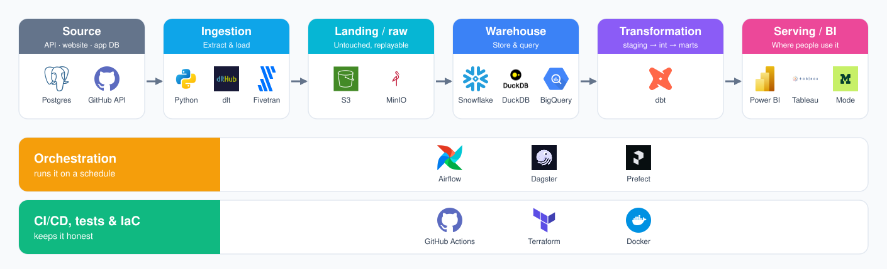

# The data stack: an overview

← Back to the [data stack guide](../README.md)

Almost every modern data platform, from a laptop project to a company with 500 engineers, has the same layers. The tools change; the layers don't.

| Layer | What it does | Example tools | The question an interviewer asks |
|---|---|---|---|
| **[Source](../1-sources/README.md)** | Where the data is born: an API, a website, an app database, a file | REST APIs, websites, Postgres, Kaggle CSVs | Why this data? Who else has it? |
| **[Ingestion (Extract & Load)](../2-ingestion/README.md)** | Gets data out of the source and into your platform, ideally only what's new | Python + `requests`, dlt, Fivetran, Airbyte | What happens if it fails halfway? How do you load only new rows? |
| **[Landing / raw](../3-landing/README.md)** | Stores data exactly as it arrived, untouched, so you can always replay | S3, GCS, local Parquet files, a `raw` schema | Can you rebuild everything from here if a model is wrong? |
| **[Warehouse](../4-warehouse/README.md)** | Where data is stored and queried | Snowflake, BigQuery, Redshift, DuckDB, Postgres, ClickHouse | Why this warehouse? What does it cost? |
| **[Transformation](../5-transformation/README.md)** | Cleans, renames, joins and models raw data into tables people can use | dbt (staging → intermediate → marts), SQL | What's the grain of this table? How do you know it's right? |
| **[Serving / BI](../6-serving/README.md)** | Where people actually use the data | Power BI, Tableau, Mode, Omni, Streamlit, a notebook | What decision does this dashboard help someone make? |
| **[Orchestration](../7-orchestration/README.md)** | Runs the steps in order, on a schedule, with retries | Airflow, Dagster, Prefect, cron, GitHub Actions | What runs when, and what happens when step 2 fails? |
| **Quality, CI/CD and infra** | Tests, linting, deployments and infrastructure as code | dbt tests, SQLFluff, GitHub Actions, Terraform, Docker | How would a teammate run this? How do you stop bad data reaching the dashboard? |

Three things to notice:

- **ELT, not ETL.** Modern stacks load raw data first and transform it inside the warehouse. That's why the landing layer matters: raw data you never overwrite means a broken model is a re-run, not a disaster. If you want the longer version, read [I tell people I'm an AE, but wtf does that mean?](https://markphammm.substack.com/p/i-tell-people-im-an-ae-so-wtf-does)
- **You can run the whole stack on a laptop.** DuckDB as the warehouse, Parquet files as the landing zone, dbt Core, Prefect or Dagster, and a free BI tool. No cloud bill, and a reviewer can clone it and run it. Cloud (Snowflake, S3, Terraform) is a level up, not a requirement.
- **Each layer is a separate concern.** Your ingestion code shouldn't clean data. Your dashboard shouldn't contain business logic that belongs in a dbt model. Mixing layers is the first thing I look for in a review.

The tour of how these tools fit together, plus the software engineering basics (repo structure, virtual environments, env vars) every project needs, is in my two-part Substack series: [Part 1: The prerequisite](https://markphammm.substack.com/p/component-of-a-technical-data-project) and [Part 2: Building blocks](https://markphammm.substack.com/p/component-of-a-technical-data-project-59e).

**In my projects:** [local_warehouse_pipeline](https://github.com/MarkPhamm/local_warehouse_pipeline) is the whole stack on one laptop: the CFPB consumer complaints API → dlt and PyArrow → Parquet in a `landing/` folder → DuckDB → dbt → dashboards, orchestrated by Prefect, with GitHub Actions CI. Zero cloud dependencies ([write-up](https://substack.com/home/post/p-178105495)). [Skytrax reviews](https://github.com/MarkPhamm/skytrax_reviews) is the same shape in the cloud: a scraper, 26 parallel Airflow tasks, S3 as the landing zone, Snowflake, dbt and Terraform ([project site](https://markphamm.github.io/skytrax_reviews/)).

— Mark Pham
