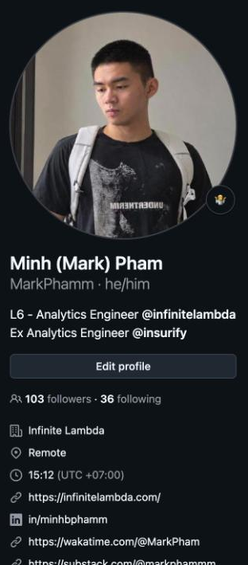
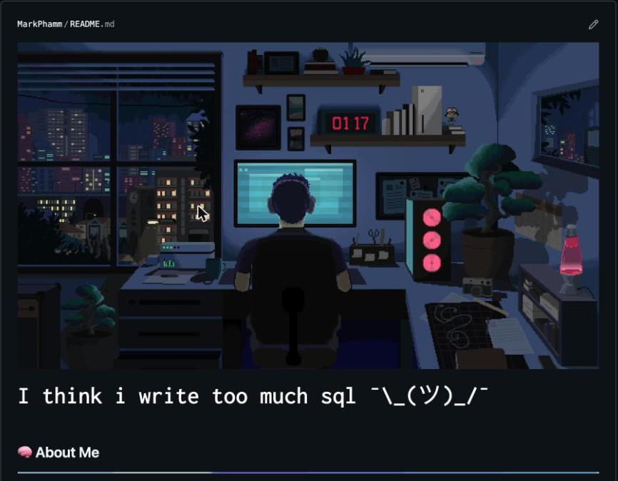
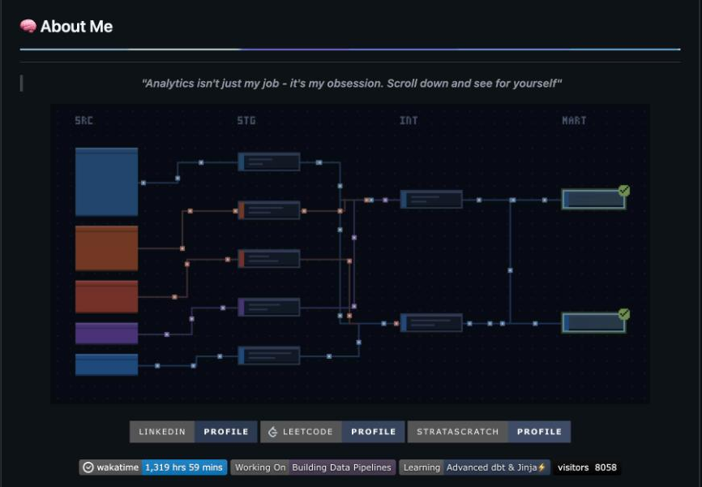
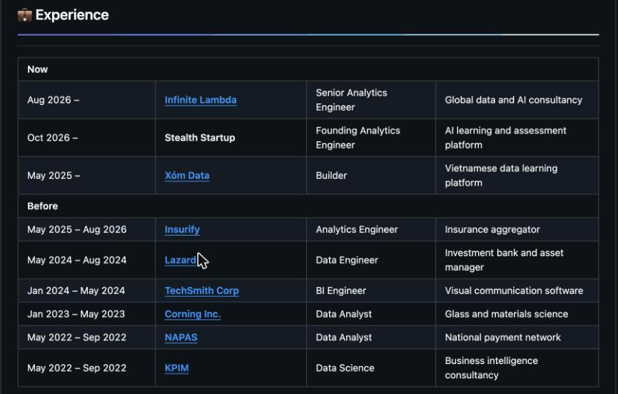
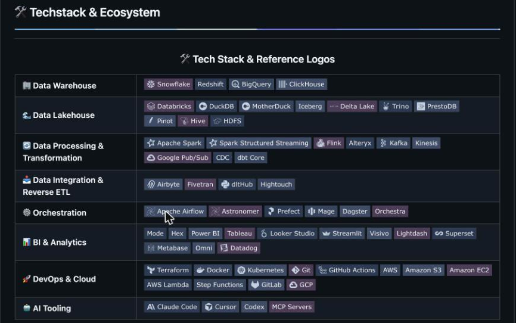
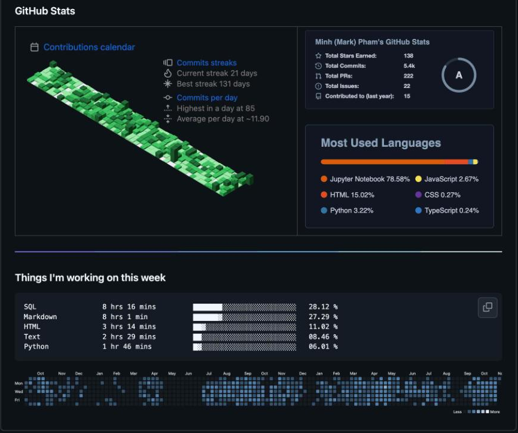
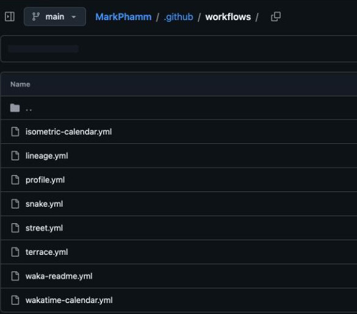
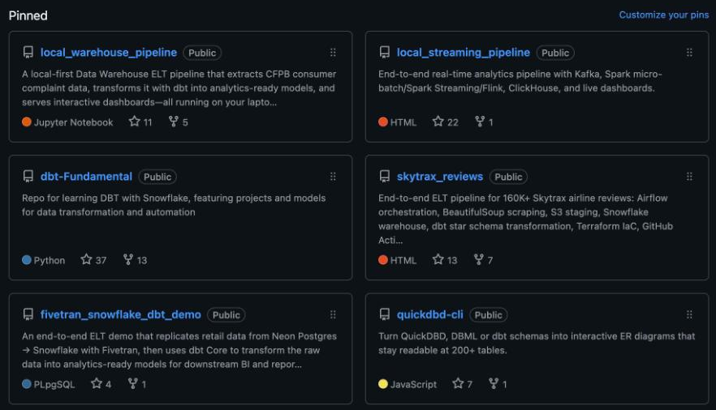
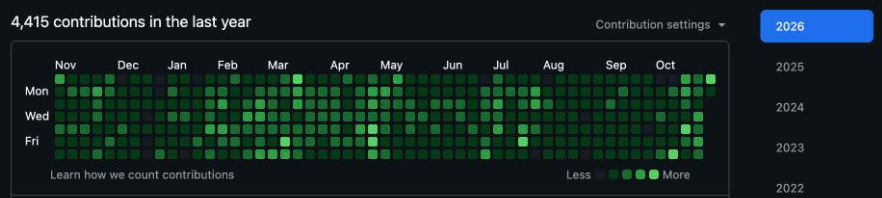
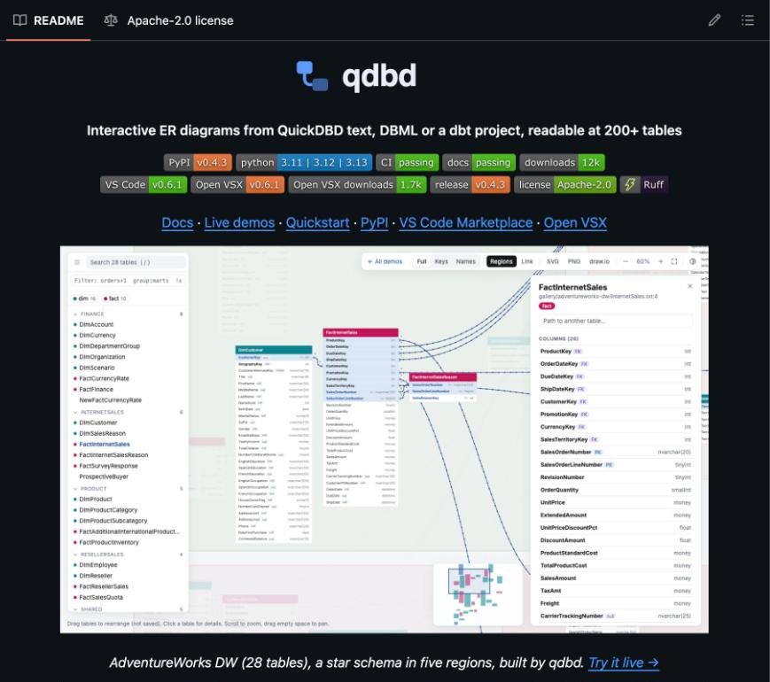

# Building a GitHub profile that proves you can do the work

Your resume and LinkedIn **claim** you can build pipelines, write SQL and model data. GitHub is where a hiring manager goes to **check**. For data roles, a good GitHub profile often matters more than a long list of skills, because it's evidence instead of adjectives.

Someone clicking through from your resume will spend about 30 seconds here. In that time they should see who you are, what you build, and one or two projects worth opening.

The problem: most candidates' GitHub looks the same. The default "Hi there 👋" README, a Titanic notebook, a Netflix EDA, a course capstone that 5,000 other students submitted. A tidy version of that is still a minion profile. **What gets you hired is the project the hiring manager has never seen before.**

So this guide starts with what to build. Then it walks through a GitHub profile in the order a visitor sees it, top to bottom, with a screenshot of the same part of [my profile](https://github.com/MarkPhamm) (November 2026) in each section. There's a [self-review checklist](#self-review-checklist) at the end.

---

## Before you start: projects nobody else has

This matters more than anything else in this guide. Presentation only amplifies what's already there.

**Projects every hiring manager has seen too many times:** Titanic, Iris, MNIST, house prices, Netflix / Spotify EDA, Superstore or AdventureWorks dashboards, COVID trackers, and anything that follows a course or YouTube tutorial step by step. They prove you can follow instructions. Everyone can.

**Ways to build something nobody else has:**

- **Collect your own data.** Scrape it, call an API, log it yourself. A dataset you built is something no other candidate has, and the scraping and cleaning is real engineering.
- **Build a tool, not just an analysis.** A CLI, a package, a bot, a dbt macro: something other people can install and use. The moment one stranger uses it, it stops being a student project.
- **Solve a real problem for real people.** Your club's membership data, a family business's sales, a nonprofit's donor list, your study group's progress. Real stakeholders give you real constraints and a story for interviews.
- **Go one level deeper than everyone else.** Everyone builds a pipeline; few add tests, CI, incremental models, Terraform and docs. Depth is a differentiator too.
- **Pick a question you actually care about.** Curiosity shows. "Do Shopee flash sales actually save you money?" is more interesting to read about than "E-commerce sales analysis".

**The copy-paste test:** if 1,000 other candidates could have the same repo, it won't get you remembered. Ask what part of yours only you could have made.

**My examples:**

- **[quickdbd-cli](https://github.com/MarkPhamm/quickdbd-cli):** a tool, not an analysis. It turns QuickDBD text, DBML or a dbt project into interactive ER diagrams that stay readable at 200+ tables. It's on PyPI and the VS Code marketplace, with CI, a docs site and live demos (screenshot in [section 5](#5-inside-a-project-the-readme)).
- **[qlineage_cli](https://github.com/MarkPhamm/qlineage_cli):** local SQL and dbt lineage for Snowflake and Redshift without a warehouse connection. It answers the question you ask all day as an analytics engineer: *what feeds this model?*
- **[Skytrax reviews](https://github.com/MarkPhamm/skytrax_reviews):** instead of downloading a Kaggle CSV, I scraped 160K+ airline reviews myself with 26 parallel Airflow tasks. The source site has since shut down permanently, so nobody can recreate this dataset.

None of these exist in anyone else's profile. That's what makes a hiring manager stop and open the repo.

---

## 1. Photo, name, bio and links



- **Photo:** the same one as LinkedIn, so people know they've found the right person.
- **Name:** your real name, the one on your resume (plus your English name in brackets if you use one).
- **Bio:** one or two lines with your role and where you work.
- **Company, location and links:** portfolio site, LinkedIn, and a blog if you have one.
- **Username:** if yours is `xXcoder2003Xx`, consider renaming it now, before you put it on your resume. GitHub redirects old repo URLs, but not your profile URL.

**On my profile:** the bio is *"L6 - Analytics Engineer @infinitelambda / Ex Analytics Engineer @insurify"*. Mentioning the company accounts with `@` turns them into links. Below that: my company, timezone (useful when you work remotely) and links to my company, LinkedIn, WakaTime, Substack and portfolio. Every other profile is one click away.

## 2. The profile README

Create a public repo with **exactly your username** as its name (mine is `MarkPhamm/MarkPhamm`). Its `README.md` shows at the top of your profile. This is your landing page.

Keep it skimmable: if it takes more than a minute to scroll through, cut it down. And **make it yours.** Thousands of profile READMEs use the same generator: a wave emoji, "I'm a passionate developer", a wall of badges and a stats card. A README that does exactly that is a minion README. Add at least one thing that's only yours: a sentence in your own voice, a fact nobody else has, a visual built from your own data.

Mine has five parts, in this order.

### 2a. A header with personality



A cover image and one line that sounds like a person. Mine is a pixel-art desk at night and *"I think i write too much sql ¯\\\_(ツ)\_/¯"*. In two seconds you know what I do and that I don't take myself too seriously.

### 2b. About me and links



One sentence, then links to the other places you exist (LinkedIn, LeetCode, StrataScratch), and what you're working on and learning right now.

**On my profile:** the diagram is a dbt-style lineage graph (source → staging → intermediate → mart) that a scheduled job **redraws every night from my own GitHub activity**. Nobody else has this image, and even someone who copied the code would get a different picture, because it's built from their data. Under it: badges for my profiles, total WakaTime coding hours, what I'm working on, what I'm learning, and a visitor counter.

### 2c. Experience



A table of roles and dates, so your career story is readable in 10 seconds. It must match your resume and LinkedIn exactly.

**On my profile:** "Now" and "Before" groups, and a fourth column with a one-line description of each company (*"Insurance aggregator"*, *"National payment network"*). Readers who haven't heard of a company still understand what it does.

### 2d. Tech stack



Group your tools by category (warehouse, transformation, orchestration, BI, cloud) rather than one long wall of badges. Only list tools you could answer an interview question about.

### 2e. Stats



Optional, but stats built from your own activity are hard to fake and say "I build things every week". Mine: an isometric contributions calendar with streaks, a GitHub stats card, most-used languages, and a "Things I'm working on this week" breakdown from WakaTime that updates every 2 hours.

### How it stays up to date



My profile repo runs **8 scheduled GitHub Actions workflows**, so the README updates itself:

| Workflow | What it does | Schedule |
|---|---|---|
| Lineage | Redraws the lineage diagram from my GitHub activity | Daily |
| Waka Readme | Updates "Things I'm working on this week" from WakaTime | Every 2 hours |
| WakaTime Calendar | Renders a coding-activity calendar | Daily |
| Snake / Isometric Calendar | Turns the contribution graph into visuals | Daily |
| Profile rotation | Rotates a section of the README | Hourly |
| Street / Terrace | Re-renders two illustrated scenes | Daily, at dawn Hanoi time |

**Your profile can demonstrate the skills it lists.** Mine claims Python, scheduling and automation, and the repo itself is scheduled Python jobs. A hiring manager who opens `.github/workflows/` sees it.

**But start simple.** Mine has nearly a thousand commits behind it. You don't need any of this automation, but you do need one thing that's only yours. Automation is a bonus.

## 3. Pinned repositories: your real resume



You can pin up to 6 repos. These matter more than anything else on the page.

- Pin **your best projects**, not forks of tutorials and not class assignments with no README.
- **Your most original project goes first,** even if it's smaller. One repo nobody else has beats four that look like everyone's.
- After that, show range: for data roles, an end-to-end pipeline, a modelling project and something that shows breadth (streaming, infra, a tool).
- Each pinned repo needs a clear **description** (the one-liner on the card) and **topics** (e.g. `dbt`, `snowflake`, `airflow`), so it's searchable.

**On my profile:** every card's description says what the project does *and* the stack, so you can scan all six in a few seconds. For example: *"End-to-end ELT pipeline for 160K+ Skytrax airline reviews: Airflow orchestration, BeautifulSoup scraping, S3 staging, Snowflake warehouse, dbt star schema transformation, Terraform IaC…"* The stars and forks show other people found them useful too.

## 4. Contribution graph



- Commit regularly because you're building, not to paint green squares. A hiring manager can tell the difference.
- A quiet month is fine. A profile that stopped two years ago is a red flag. Keep at least one project moving.
- Contributing to open source, even docs fixes, counts and is easy to talk about in interviews.

**On my profile:** 4,415 contributions in the last year. The graph is green almost every week because there's always a project moving, not because I'm chasing squares.

## 5. Inside a project: the README



A good project with a bad README looks like a bad project. Use this template:

```markdown
# Project name
One sentence: what it does and why it matters.


## Problem
What question or business problem does this answer? Where does the data come from,
and why is this data or question different from what everyone else uses?

## Stack
Airflow · dbt · Snowflake · Power BI (and why you picked them)

## How it works
3–6 bullets walking through the pipeline, source → output.

## Results
Screenshots of the dashboard, key numbers, what you found.

## Run it yourself
Exact commands. Assume the reader has never seen your machine.

## What I'd do next
Honest limitations and next steps. Interviewers love this section.
```

The architecture diagram or screenshot is the single highest-value addition. draw.io, Excalidraw or a Mermaid diagram are all fine.

**On my profile:** the quickdbd-cli README opens with a logo, a one-line pitch (*"Interactive ER diagrams from QuickDBD text, DBML or a dbt project, readable at 200+ tables"*), then badges that prove it's real: PyPI version, CI passing, docs passing, 12k downloads, VS Code and Open VSX versions. Then links to docs, live demos and quickstart, and a screenshot of the actual product with a "Try it live" link. Within five seconds, a visitor knows what it is, that people use it, and how to try it.

## 6. Signals that you think like a production engineer

These are what separate a student project from one that gets you hired:

- **Tests:** dbt tests, `pytest`, data quality checks.
- **CI:** a GitHub Actions workflow that lints SQL (e.g. `sqlfluff`) or runs `dbt build` on each pull request. Show it with a badge, like the "CI passing" badge above.
- **Docs:** dbt docs, a docs site, or at least a data dictionary.
- **Infrastructure as code:** Terraform or Docker Compose, so anyone can stand it up.
- **Pull requests on your own repos:** work on a branch, open a PR, merge it. It shows you know the workflow teams actually use.

## 7. Repo hygiene

- **Never commit secrets.** No passwords, API keys, `.env` files or `profiles.yml` with credentials. If you already did, rotate the key; deleting the file doesn't remove it from history.
- Add a `.gitignore` before your first commit (Python, dbt `target/`, `logs/`, `.venv`).
- Don't commit large raw datasets. Link to the source or include a small sample.
- Clear Jupyter notebook outputs that dump thousands of rows.
- Name repos descriptively: `airline-reviews-pipeline`, not `project3` or `final_final_v2`.
- Write commit messages that say what changed: `Add incremental model for daily bookings`, not `update`.

---

## Common mistakes

- **A minion GitHub:** tutorial projects, a template README, nothing that only you could have made.
- No profile README, or the default "Hi there 👋" template untouched.
- Pinned repos are forks, tutorials or empty.
- Pinning course capstones and Kaggle classics as if they were original work.
- Projects with no README, or a README that's only `npm install`.
- A wall of 60 technology badges, half of which you've never used.
- Secrets or personal data committed to a public repo.
- Different titles or dates than your LinkedIn and resume.

---

## Self-review checklist

**Projects**

- [ ] At least one pinned project uses data I collected, solves a real problem for real people, or is a tool other people can use.
- [ ] **Copy-paste test:** no pinned repo is something 1,000 other candidates also have (Titanic, Netflix, Superstore, course capstones).

**Top to bottom**

- [ ] Photo, real name, bio, location and links are filled in.
- [ ] I have a profile README (repo named exactly like my username) with at least one thing only I could have written or built.
- [ ] Experience titles and dates match my resume and LinkedIn exactly.
- [ ] Tech stack is grouped by category and only lists tools I can talk about.
- [ ] 4–6 pinned repos, each with a description (what + stack) and topics.
- [ ] I've committed something in the last month.

**Inside each pinned project**

- [ ] README with a one-line pitch, problem, stack, architecture diagram or screenshot, results and run instructions.
- [ ] At least one project has tests and CI.
- [ ] No secrets, credentials or large raw data committed anywhere.
- [ ] Repo names and commit messages are descriptive.
