# Building a LinkedIn profile that gets you hired

Recruiters don't read LinkedIn profiles the way you read a resume. They **search** for people by keywords, skim the search result (photo, name, headline), and only then click through. So your profile has two jobs:

1. **Show up** in searches for the role you want.
2. **Convince** someone in 10 seconds that you're worth a message.

**Showing up is the easy part.** Put the right keywords in the right places and you'll appear in searches, along with hundreds of other people who did exactly the same thing. **Convincing is where almost everyone fails**, because their profiles are interchangeable. A recruiter who has just seen 50 *"Aspiring Data Analyst | SQL · Python · Power BI"* headlines will not stop for the 51st.

So keywords get you found; **differentiation gets you hired.**

The sections below follow the order they appear on a LinkedIn profile, top to bottom. Each one has a screenshot of the same section on [my profile](https://www.linkedin.com/in/minhbphamm/) (November 2026), so you can see it in practice. Each section ends with a short checklist, and the full [self-review checklist](#self-review-checklist) is at the end.

---

## Before you start

### Pick one target role

Write down the single job title you want next, for example *Analytics Engineer*, *Data Engineer* or *Data Analyst*. Then open 5 job posts for that title and note the words that repeat (tools, skills, responsibilities). Those words are your keywords. They should appear in your headline, About, Experience and Skills.

If you try to target three roles at once, you'll rank for none of them.

### Find your angle

Keywords are what you share with every other candidate. Your angle is what you don't. Write down 3–5 **only-me facts**, things that are true about you and not about the rest of the pile:

- **A number you produced:** money saved, runtime cut, users served, problems solved. "Solved 1,000+ SQL problems" is a number; "proficient in SQL" is not.
- **Something you built that other people use:** a tool, a dataset, a bot, a dashboard your club actually checks every week.
- **Something you run:** a community, a newsletter, a study group, a club, a mentoring squad.
- **Data nobody else has:** you scraped it, collected it, or got it from a real organisation.
- **An unusual path:** ex-accountant, ex-teacher, a founder, an athlete, a different country. Career switchers: your old field is an advantage, not something to hide.
- **An obsession:** the thing you do for fun that happens to be relevant.

If you can't write a single one yet, that's your real to-do list. Go build or do one thing worth talking about before polishing the profile. These facts go into every section below.

**Checklist:**

- [ ] I've written down one target role.
- [ ] I've noted the keywords that repeat across 5 real job posts for it.
- [ ] I've written down 3–5 only-me facts.

---

## 1. Banner and photo

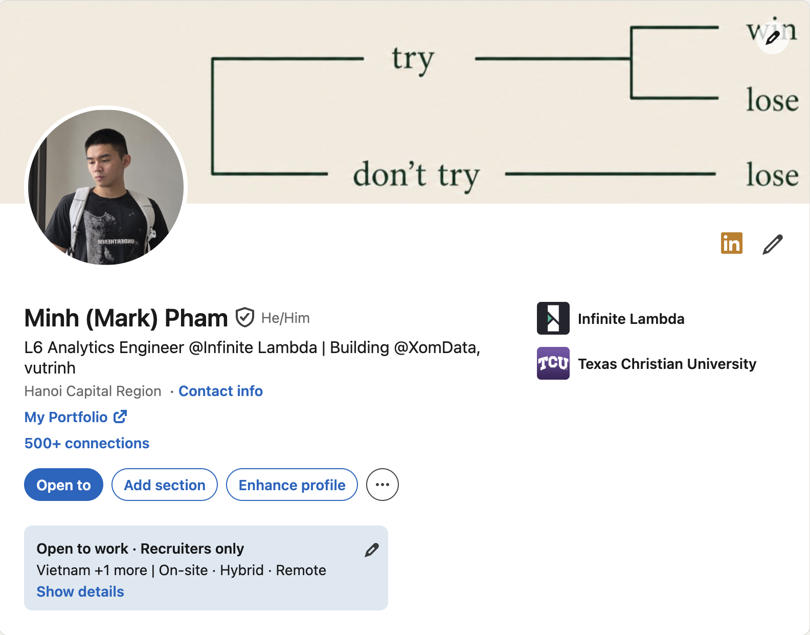

- **Photo:** your face fills most of the frame, plain background, good light, you look like someone people would enjoy working with. No group shots, no sunglasses, no graduation-cap crops.
- **Banner (1584 × 396 px):** the biggest image on your profile, and most people leave LinkedIn's default blue, or upload a generic "data" stock image. Both are minion banners. Use it to say something about you.

**On my profile:** the banner is a decision tree, not a logo or a list of tools: *try → win or lose; don't try → lose*. It's my philosophy in one picture, and the same idea shows up again in my About section and on my portfolio, so the whole profile feels like one person.

**Checklist:**

- [ ] My face fills most of the photo, with a plain background and good light.
- [ ] My banner says something about me. It isn't LinkedIn's default blue or a stock "data" image.

## 2. Name and headline

**Name:** use the name on your resume. If you go by an English name at work, add it in brackets, like *Minh (Mark) Pham*. It helps international recruiters and colleagues find and address you.

**Headline (up to 220 characters):** the most important line on your profile. It shows in search results, in comments and in connection requests.

**The minion headline** is `Aspiring <role> | <3 tools> | <vague mission>`. It's what every guide on the internet tells you to write, which is exactly why it doesn't work: it's correct, searchable and completely forgettable.

**Build yours from your only-me facts instead:** the role you want, then one or two things nobody else in the search results can say.

| Situation | Minion (everyone writes this) | Stands out |
|---|---|---|
| Student | Aspiring Data Analyst \| SQL · Python · Power BI \| Passionate about data | Scraped 2M Shopee prices to find out if flash sales are real (mostly not) \| Data Analyst intern hunting \| 600+ SQL problems solved |
| Career switcher | Accountant → Data Analyst \| SQL · Excel · Tableau \| Automating finance reporting | Ex-auditor who automated my team's month-end close from 5 days to 1 \| Now doing it full-time as a Data Analyst |
| Early career | Analytics Engineer \| dbt · Snowflake · Airflow \| Turning messy data into models people trust | Analytics Engineer @XYZ \| Cut our dbt run from 3h to 40 min \| Running a 2,000-member SQL study group |

The right column is made up for illustration. **Don't copy it**, because then it's a minion headline again. Use your own facts.

Rules:

- **Specific beats impressive.** "Cut runtime from 3h to 40 min" beats "Optimizing data pipelines".
- **Keep one or two keywords** (usually the role title) so you still show up in search. You don't need to list every tool; that's what Skills is for.
- **A bit of personality is a feature.** If it makes someone smile or wonder, they click.
- **Ban list:** aspiring, passionate, results-driven, detail-oriented, motivated, enthusiast, team player, "turning data into insights". If a word appears in every other headline, it adds nothing to yours.
- **Run the copy-paste test.** If 1,000 other people could use your headline unchanged, rewrite it.

**On my profile:** *"L6 Analytics Engineer @Infinite Lambda | Building @XomData, vutrinh"*. The role and level come first for search, then two things I build outside my job that nobody else in an "Analytics Engineer" search can claim. No list of tools, no buzzwords. My headline changes as my story changes; a few months ago it ended with *"Solving 1000s SQL Questions for fun | Curious individual"*.

**Checklist:**

- [ ] My name matches my resume (with my English name in brackets if I use one).
- [ ] My headline has my target role plus at least one only-me fact.
- [ ] None of the ban-list words.
- [ ] **Copy-paste test:** 1,000 other people couldn't use my headline unchanged.

## 3. Location, contact info and links

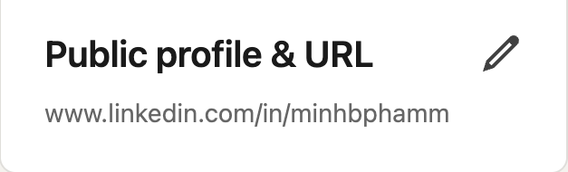

- **Location:** the city you want to work in. Mine is Hanoi Capital Region.
- **Contact info:** an email you actually check, plus your GitHub, portfolio and blog.
- **Link under your headline:** in **Edit intro**, add a website and its link text. It shows directly under your headline, one click from the top of your profile. Point it at your strongest proof. Mine says **My Portfolio**.
- **Custom URL:** change `linkedin.com/in/nguyen-van-a-8b3c21a7` to something clean, like mine: `linkedin.com/in/minhbphamm`. Go to your profile → **Public profile & URL** (top right) → edit the URL. Put the same URL on your resume, GitHub and portfolio.

**Checklist:**

- [ ] Location is the city I want to work in.
- [ ] Contact info has an email I check, plus my GitHub, portfolio and blog.
- [ ] The link under my headline points at my strongest proof.
- [ ] Custom URL set, and it's on my resume, GitHub and portfolio.

## 4. Open to Work

Turn it on and fill in the job titles, locations and work types; recruiters filter on them. If you're employed, choose **Recruiters only** so there's no green frame on your photo.

**On my profile** (in the top card above): *Recruiters only · Vietnam +1 more · On-site, Hybrid, Remote*.

**Checklist:**

- [ ] Open to Work is on, with job titles, locations and work types filled in.
- [ ] If I'm employed, it's set to **Recruiters only**.

## 5. About and Top skills

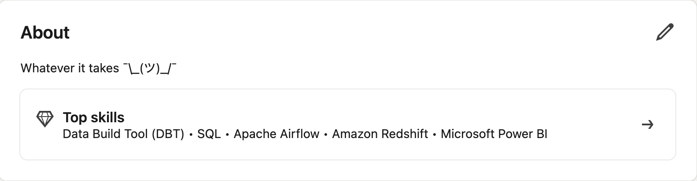

Up to 2,600 characters, and only the first ~3 lines show before "see more", so open strong. A structure that works:

1. **Hook (1–2 sentences):** something specific that nobody else could write. Not "I am a passionate data analyst with a strong foundation in SQL", which opens thousands of profiles. Start with a story, a result or a strong opinion: "I spent six months as an auditor reconciling spreadsheets by hand, then automated the whole thing in a weekend. That's when I knew."
2. **What you work on (2–3 sentences):** the kinds of problems, your stack, the domain.
3. **Proof (2–4 bullets):** your only-me facts, with numbers.
4. **What you're looking for + how to reach you:** "Open to Analytics Engineering roles in Ho Chi Minh City or remote. Reach me at …"

Write in first person, in your own voice. Read it out loud: if it could be anyone's About section, it isn't doing its job.

**Top skills:** pick the 5 skills that match your target role. They show in a box under your About, so they're always visible.

**On my profile:** my About is one line: *"Whatever it takes ¯\\\_(ツ)\_/¯"*. It's memorable because it's unusual, and it works because everything below it backs it up: roles, numbers, side projects and recommendations. A short About is only a strength when the rest of the profile proves it. Early in your career, write the full version above, and make the hook yours. My Top skills (dbt, SQL, Airflow, Redshift, Power BI) are the tools of the job I do.

**Checklist:**

- [ ] The first 3 lines open with a hook only I could write.
- [ ] It covers what I work on, proof with numbers, what I'm looking for and how to reach me.
- [ ] I read it out loud, and it couldn't be anyone else's About.
- [ ] Top skills are the 5 that match my target role.

## 6. Featured

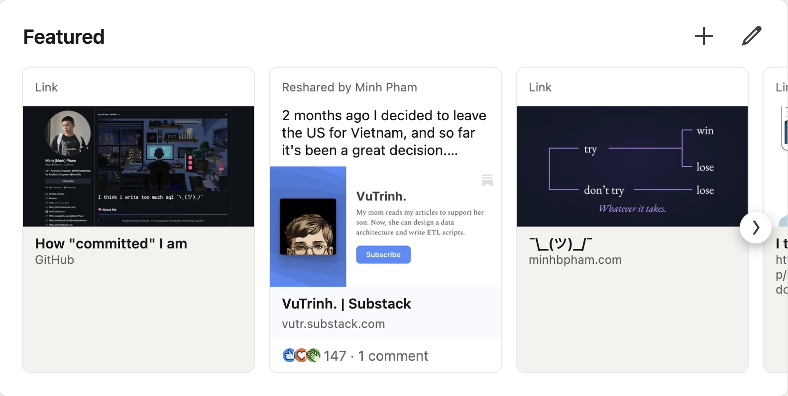

Your best 2–4 pieces of proof, pinned near the top: a portfolio site, a GitHub repo or profile, a project write-up, a talk, a post that did well. Pick things a recruiter can understand in under a minute, and **things only you have**. Ten candidates can feature the same course certificate; nobody else can feature your project.

You can change the title of a featured link, so don't settle for "My GitHub".

**On my profile:**

- **My GitHub profile, titled *How "committed" I am*.** It's a joke about commits, and much more clickable than "GitHub".
- **A post I reshared from vutrinh**, where I write, with 147 reactions. It's proof from someone else's platform.
- **My portfolio**, shown with the same try / don't-try image as my banner, captioned "Whatever it takes". Banner, About and portfolio all repeat the same idea.

**Checklist:**

- [ ] 2–4 items, each something I built or wrote, not a course certificate.
- [ ] A recruiter can understand each one in under a minute.
- [ ] Each link has a title worth clicking, not "My GitHub".

## 7. Experience

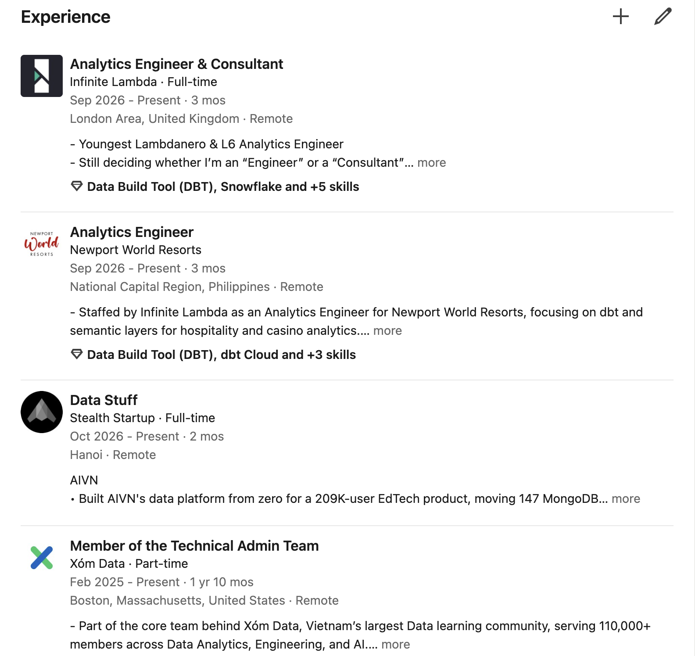

This is where recruiters decide whether you can do the job.

- **One entry per role, with real dates.** Internships, co-ops, part-time and freelance work all count. List them.
- **One line of context**, then **2–4 bullets**. Each bullet is *action + tool + result*:

  > ❌ Responsible for building dashboards.
  >
  > ✅ Built a Power BI sales dashboard on top of SQL Server that replaced a weekly manual Excel report, saving the sales team ~6 hours/week.

- **Numbers wherever honest:** hours saved, rows processed, cost cut, adoption, latency, number of stakeholders.
- **Use your keywords** in the bullets, not just in Skills.
- **Specifics are what make you memorable.** Everyone "built dashboards". Only you "found that 40% of refunds came from one courier, and the ops team changed courier the next month".
- **Attach skills to each entry**, so recruiters see *where* you used them.
- **Titles tell a story.** Read your titles top to bottom. They should point toward your target role.
- **Keep it consistent** with your resume. Same titles, same dates. Recruiters do check.

**On my profile:**

- **Client work gets its own entry.** I'm a consultant at Infinite Lambda, and I'm currently placed with Newport World Resorts, so that's a separate entry: *"Staffed by Infinite Lambda as an Analytics Engineer for Newport World Resorts, focusing on dbt and semantic layers for hospitality and casino analytics."* A recruiter immediately sees the domain, not just the consultancy's name.
- **Concurrent work is listed, with a number.** *"Built AIVN's data platform from zero for a 209K-user EdTech product."*
- **Community work sits next to paid work.** Xóm Data, Vietnam's largest data learning community (110,000+ members), is a part-time role in my Experience. If you run a club, community, newsletter or open-source project, list it.
- **A bit of personality is fine.** *"Still deciding whether I'm an 'Engineer' or a 'Consultant'"* makes people smile. Keep it to one line per role; the rest should be substance.

Further down, my Insurify entry is the best model for bullets with numbers:

> Refactored a 300GB+ RTB bidding dbt model: non-SARGable filters → anti-joins, pruned upstream deps, tuned DISTKEY and SORTKEY – cutting storage 100GB and runtime 50%

> Investigated cross-channel spend discrepancies across 13 partner networks using end-to-end data lineage; reconciled LTV/CAC across channels in Mode, recovering $500K and improving unit economics by 25%

Notice the specific tools (dbt, Redshift keys, Mode), the scale (300GB+, 13 networks) and the outcome ($500K, 50%). That entry also shows two positions under one company (Marketing Tech & Growth Partnerships → Core Analytics). Use LinkedIn's "add position" for an internal move, so it reads as growth.

Further down still: internships at NAPAS, KPIM, Corning, TechSmith and Lazard, each with its own dates, plus teaching assistant, tutor, founder and even intramural referee. Read bottom to top, the titles go Data Analyst → BI Engineering Intern → Data Engineer Intern → Analytics Engineer → Analytics Engineer & Consultant. Arrange yours so the direction is just as clear.

**Checklist:**

- [ ] Every role is listed with real dates, internships, part-time and freelance included.
- [ ] Each one has a line of context and 2–4 bullets: action + tool + result.
- [ ] Numbers wherever they're honest, and my keywords in the bullets.
- [ ] Skills attached to each entry.
- [ ] Read top to bottom, my titles point toward my target role.
- [ ] Titles and dates match my resume exactly.

## 8. Education

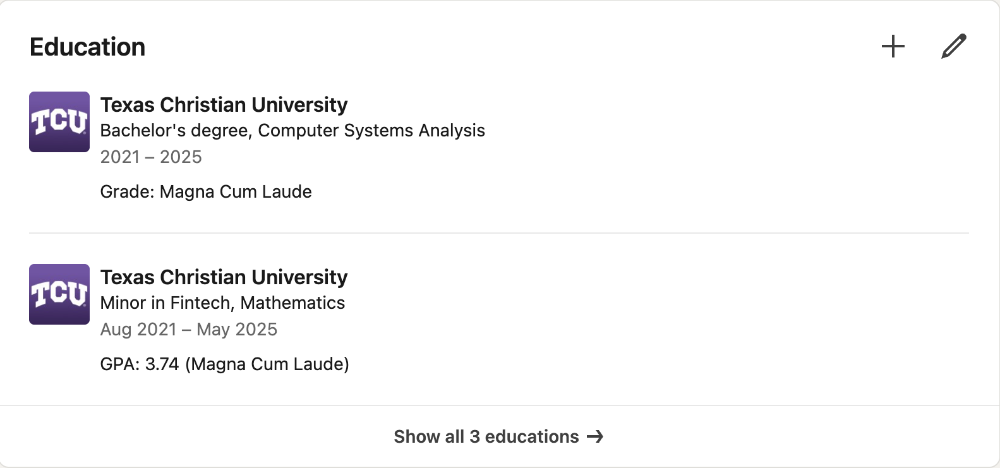

Degree, school, dates. Add honours, a strong GPA, minors or a thesis only if they support your story. Leave out anything that doesn't help.

**On my profile:** each entry includes the honours line (*Magna Cum Laude*, *GPA 3.74*), and the minor in Fintech and Mathematics is its own entry.

**Checklist:**

- [ ] Degree, school and dates match my resume.
- [ ] Honours, GPA, minors or a thesis only if they support my story.

## 9. Licenses and certifications

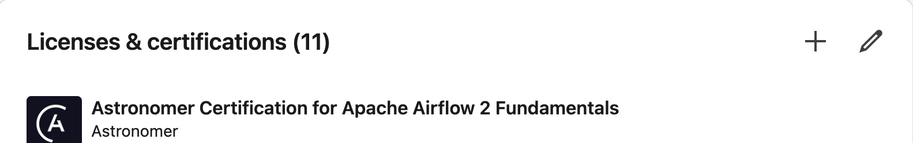

Certifications that carry weight in data: dbt, Snowflake, Databricks, Astronomer (Airflow), AWS / GCP / Azure data certs. Course-completion certificates are fine early on, but they're the most minion part of any profile, because everyone has the same ones. Don't let them crowd out real work.

**On my profile:** 11, with the Astronomer Apache Airflow certification first because it's the most relevant to my job.

**Checklist:**

- [ ] The most relevant certification comes first.
- [ ] Course-completion certificates don't crowd out real work.

## 10. Projects

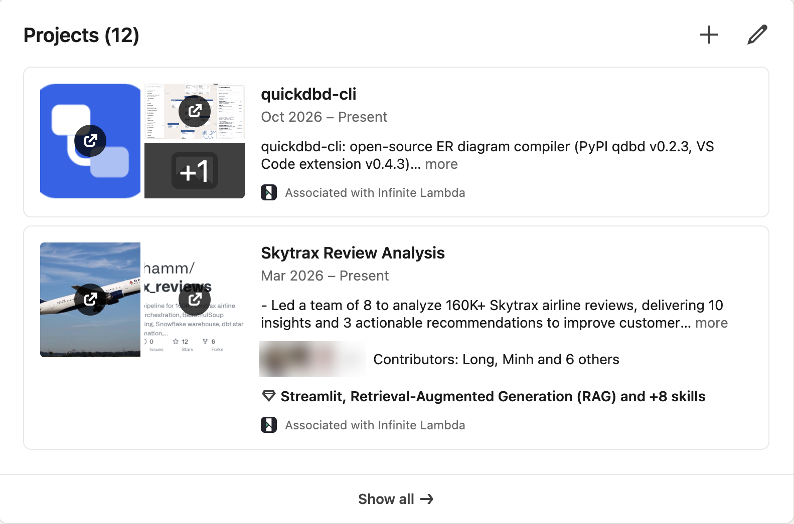

If you don't have much work experience yet, projects are your experience. For each one:

- What problem, what data, what stack.
- A link and a thumbnail (GitHub, dashboard, article).
- One sentence on the result.
- **Tag your collaborators** and **associate it with a company or school** where it fits.

One finished, well-documented project beats five half-done tutorials.

**Skip the projects every candidate has:** Titanic, Iris, Netflix, Superstore, COVID dashboards, house-price prediction on the Kaggle dataset. Recruiters have seen hundreds of them. Use data you collected yourself, data from a real organisation (a club, a family business, a nonprofit), or a question you actually care about. The [GitHub guide](../github/README.md#before-you-start-projects-nobody-else-has) has more on this.

**On my profile:** 12 projects, with the two most original first:

- **quickdbd-cli:** an open-source ER diagram compiler, published on PyPI with a VS Code extension. A tool other people install, not an analysis.
- **Skytrax Review Analysis:** *"Led a team of 8 to analyze 160K+ Skytrax airline reviews, delivering 10 insights and 3 actionable recommendations"*, with the 7 contributors tagged and skills attached.

**Checklist:**

- [ ] Each project has the problem, data, stack, a link, a thumbnail and one sentence on the result.
- [ ] Collaborators tagged, and associated with a company or school where it fits.
- [ ] No Titanic / Iris / Netflix / Superstore / COVID / Kaggle house-price projects.
- [ ] My most original project comes first.

## 11. Skills

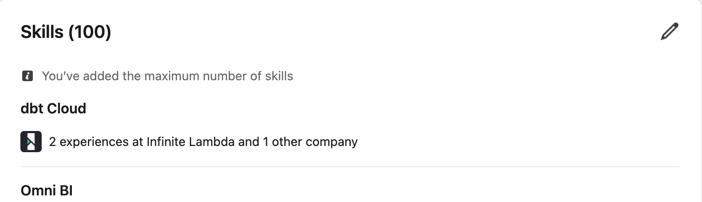

- Add the tools and skills from your keyword list. Remove ones you couldn't answer an interview question about.
- What matters most is your **Top skills** (section 5) and **which experiences each skill is attached to**. "dbt Cloud · 2 experiences at Infinite Lambda and 1 other company" is proof; a bare skill name isn't.

**On my profile:** I've reached LinkedIn's limit of 100 skills, but nobody reads all 100. They read the top ones and where I used them.

**Checklist:**

- [ ] Skills come from my keyword list.
- [ ] I could answer an interview question on every one.
- [ ] My important skills are attached to the experiences where I used them.

## 12. Recommendations

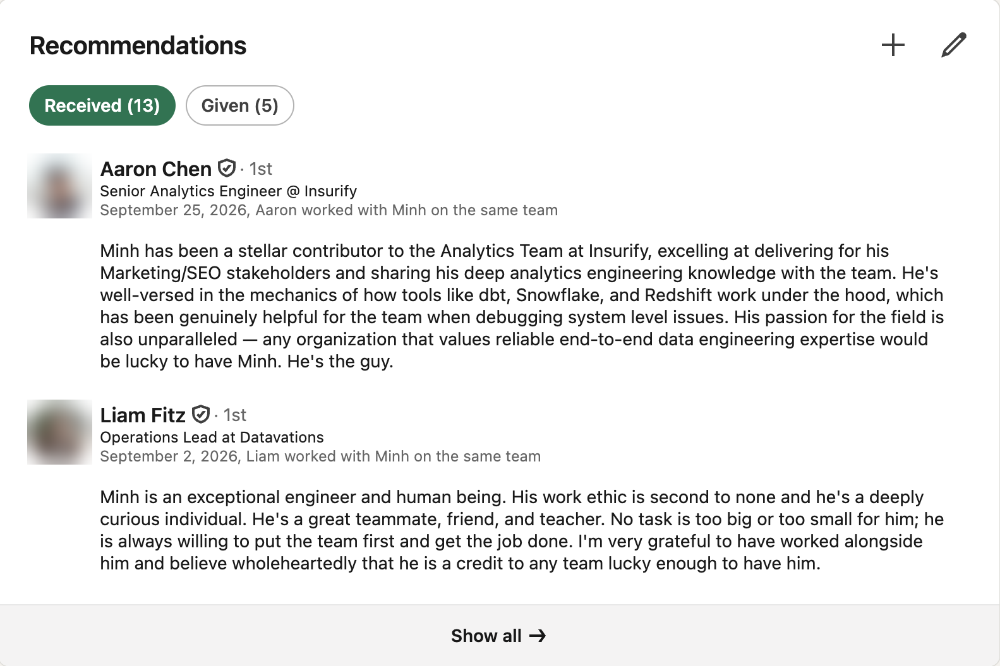

Most profiles skip this section, and that's exactly why it's worth doing. A recommendation is the one part of your profile **you can't write yourself**, which is why recruiters trust it more than anything else on the page.

- **Ask at the right moment:** when you leave a team, finish an internship or ship something big, while the details are fresh.
- **Make it easy:** tell the person what you'd like them to mention (a project, a skill, how you worked with stakeholders). Specific recommendations are far stronger than "great team player".
- **Give first.** Write honest, specific recommendations for people you've worked with. Many will return the favour.
- **Aim for variety:** a manager, a teammate, a stakeholder, a mentor.

**On my profile:** 13 received and 5 given. Look at how specific the first one is: Marketing/SEO stakeholders, and knowing how dbt, Snowflake and Redshift work under the hood. That's far more convincing than anything I could write about myself.

**Checklist:**

- [ ] I've asked for at least one, ideally from a manager, and told them what I'd like them to mention.
- [ ] I've written at least one honest, specific recommendation for someone else.

## 13. Courses

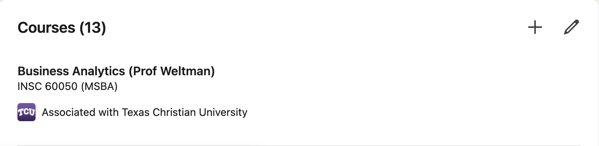

Mostly useful for students and recent graduates: list the courses that support your target role, with the course code, and associate them with your school. Skip general-education courses.

**On my profile:** 13 courses, such as *Business Analytics (INSC 60050, MSBA)*.

**Checklist:**

- [ ] Only courses that support my target role, with the course code, associated with my school.

## 14. Activity: be visible

Once you post, your recent activity appears on your profile. A profile with no activity looks abandoned. You don't need to become an influencer:

- Comment thoughtfully on posts from people in your target field, 2–3 times a week.
- Post once every week or two: something you built, learned, or got wrong. Short and specific beats long and generic.
- **Have a take.** Reposting "10 SQL tips" makes you one of a thousand people who reposted it. Saying what you actually think, and why, makes you someone people remember.
- Connect with people you've actually interacted with, and always add a note.

**Checklist:**

- [ ] I comment on posts in my target field 2–3 times a week.
- [ ] I've posted something I built, learned or got wrong in the last two weeks.
- [ ] My posts say what I think, not reposted tips.
- [ ] Every connection request has a note.

---

## Everything links together

My LinkedIn links to my portfolio (under the headline) and my GitHub (in Featured). My GitHub profile README and my portfolio both link back. A recruiter who lands on any one of them can find the others. Make sure they all tell the **same story with the same titles and dates**, and update them together whenever something changes.

**Checklist:**

- [ ] My LinkedIn links to my GitHub and portfolio, and both link back.
- [ ] Titles and dates match across LinkedIn, GitHub, my portfolio and my resume.

---

## Common mistakes

- **A minion profile:** every line passes for anyone else's. This is the most common mistake and the most expensive one.
- Default banner, or a generic "data" stock image.
- Headline still says "Student at …" or only your current job title.
- Empty About, or an About copied from a resume objective.
- Experience bullets that list duties instead of results.
- Different titles or dates on LinkedIn vs. your resume.
- 40 skills, half of them unrelated to the job you want, none attached to experience.
- No recommendations.
- No links to anything you've built.
- Typos. Run everything through a spell checker.

---

## Self-review checklist

Go through this before you send me your profile.

**Before you start**

- [ ] I've written down one target role and 10–15 keywords from real job posts.
- [ ] I've written down 3–5 only-me facts, and they appear across my profile.

**Section by section**

- [ ] Professional photo; a banner that says something about me (not the default or a stock image).
- [ ] Headline has my target role plus at least one only-me fact, and none of the banned words.
- [ ] Location set; contact info has an email I check; my strongest link shows under my headline.
- [ ] Custom URL, and it's on my resume, GitHub and portfolio.
- [ ] Open to Work set with the right titles, locations and work types.
- [ ] About: a hook only I could write, proof with numbers, what I'm looking for and how to reach me. Top skills set.
- [ ] Featured has 2–4 things I've built or written, with titles worth clicking.
- [ ] Every role (internships included) has dates, 1 line of context and 2–4 result-focused bullets with skills attached.
- [ ] Titles and dates match my resume exactly.
- [ ] Projects: no Titanic / Iris / Netflix / Superstore-style projects; collaborators tagged.
- [ ] At least one recommendation, ideally from a manager, and I've written at least one for someone else.
- [ ] I've commented or posted at least once in the last two weeks.

**Finally**

- [ ] **Copy-paste test:** no line on my profile could be pasted unchanged into 1,000 other profiles.
- [ ] I read the whole profile out loud and fixed every typo.
