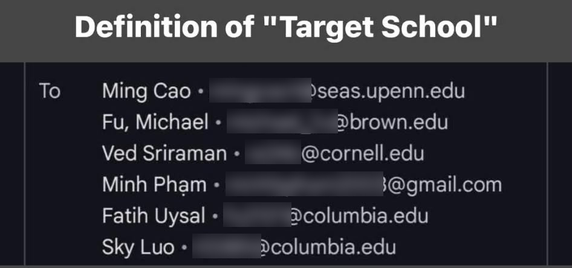

*Part of [Mentality](../README.md) · Previous: [3. Detach](../3-detachment/README.md) · Next: [5. Push to failure](../5-push-to-failure/README.md)*

# 4. Find your competitive advantage

> **Why would I hire you instead of an Ivy League kid?**

Every recruiter is asking this question, even if they never say it out loud. Answer it before they have to ask.

[Don't be a minion](../1-dont-be-a-minion/README.md) tells you to stand out. This part is about **what** to stand out with.

## You won't beat them on their terms

The Ivy League kid has the brand name, the alumni network, the on-campus recruiting and a resume that gets a second look because of one line at the bottom. If you try to compete on pedigree, you lose, every time. So don't play that game. **Compete on an axis where they can't follow you.**

They have the name. You can have things a name can't buy:

- **Proof of work.** Projects with real data, tools people use, numbers you produced. A degree says you *could* do the job. Shipped work shows you already *can*.
- **A head start.** Years of practice they spent on other things. If you've been writing SQL since high school, a famous school doesn't close that gap.
- **Hunger and ownership.** You found the internship without a career centre handing it to you. You taught yourself the stack. You built the thing nobody asked you to build.
- **Context they don't have.** Your languages, your market, your domain. A company expanding into Vietnam, or a team full of finance data, gets more from you than from a generalist with a better logo.
- **People who vouch for you.** A community you run, mentees you teach, managers who'll pick up the phone.

## How I got into Lazard

In the final round for my data engineering internship at Lazard, I was up against Ivy League students. This is the email that went out to the interns who got the offer:

Penn, Brown, Cornell, Columbia, Columbia… and one personal Gmail. Mine. TCU isn't a target school, so I didn't have a target-school email. (Another intern joined later. Obviously, he was from Stanford.)

On school, I was completely mogged. And they're some of the smartest people I've ever met:

- [Sky Luo](https://www.linkedin.com/in/skyluo24/) is now at Bloomberg.
- [Ming Cao](https://www.linkedin.com/in/ming-chao-a736981b2/) continued her research at NYU.
- [Ved Sriraman](https://www.linkedin.com/in/vedsriraman/) became a CS PhD student at Columbia.
- [Michael Fu](https://www.linkedin.com/in/michaelyfu/) became a Forward Deployed Engineer at Palantir.
- [Fatih Uysal](https://www.linkedin.com/in/fatih-e-uysal/) became a quant at Citibank.

So how did I get the same offer? **Not the school.**

- **I studied exactly the tech stack they used.** Not "data engineering" in general: their tools, their warehouse, the problems a team like theirs actually has.
- **I networked with people on the team before the interview.**
- **I spent two days studying Snowflake non-stop.**

That's the answer to "why would I hire you instead of an Ivy League kid?" **You won't out-school them. You can out-prepare them.** The name opens doors for them. You have to open your own, so prepare like it.

## Your answer is already in your story

Everyone has something that's true about them and not about the rest of the pile. Most people never find theirs, because they're too busy copying what everyone else lists: SQL, Python, Power BI, "team player". Your competitive advantage is usually hiding in plain sight, in your background, your timing and your story. **Find it, then pitch it.**

## Where to look

Go through these and write down everything that applies, even if it feels small or unrelated:

- **Where you come from:** your school, your city, your country, the languages you speak. A school that's famous where you're applying is a signal on its own.
- **When you started:** if you started learning something years before everyone else, that's a head start nobody can take away.
- **What you won:** scholarships, competitions, awards, honours. Someone else already selected you over a crowd, and that tells a recruiter something.
- **What you've done that most people your age haven't:** internships in more than one country, a business you started, a community you run, people you teach.
- **Where you've been before data:** a previous career, a family business, a domain you know from the inside (finance, healthcare, logistics, retail). Domain knowledge is something pure-tech candidates don't have.
- **What you've overcome:** studying abroad on your own, working while studying, switching careers, learning in a second language.
- **What you're obsessed with:** the thing you'd do on a Friday night anyway. Obsession shows, and it's rare.

## Examples

**Me:**

- I went to **Hanoi-Amsterdam High School for the Gifted**, one of Vietnam's most selective high schools.
- I've been **learning SQL since 2020**, while I was still in high school, which is years before most people touch it. I've solved 1,000+ SQL problems since.
- I did **three internships in two countries** (NAPAS and KPIM in Hanoi, Corning in the US) before my senior year of university.
- I **founded a small consulting academy** that helped 20 Vietnamese students apply to US universities.
- I'm a **moderator of Xóm Data**, Vietnam's largest data learning community (110,000+ members).
- I became the **youngest L6 Analytics Engineer** at Infinite Lambda.

None of these is "knows SQL and Python". Every candidate claims that. These are mine.

**Mia Tran, one of my mentees:** she went to **Smith College on a full ride**. A full scholarship to a selective US college means someone already compared her with a lot of strong applicants and picked her. That's a signal most of the people she's competing with simply don't have, and it belongs at the top of how she presents herself, not buried in her Education section.

Your list will look different. That's the point.

## Make it mean something to them

A fact only becomes an advantage when the person reading it understands why it matters. Two things to check:

- **Translate it for your audience.** A Vietnamese recruiter knows Hanoi-Amsterdam. A recruiter in London or Boston probably doesn't, so add the context: "one of Vietnam's most selective high schools". The same goes for your university, your scholarship or your company if they're not famous where you're applying.
- **Connect it to the job.** Answer the "so what?" for them. "Started SQL in high school" becomes "six years of SQL, 1,000+ problems solved". "Full ride to Smith" becomes "selected for a full scholarship". "Ex-accountant" becomes "I understand the finance data I'll be modelling, because I used to produce it".

## Pitch it

Once you have it, use it everywhere, consistently:

- **The first lines of your LinkedIn headline and About** ([LinkedIn guide](../../linkedin/README.md)).
- **The top of your resume and the context lines in your Experience** ([resume guide](../../resume/README.md)).
- **The hero of your portfolio** ([portfolio guide](../../portfolio/README.md)).
- **The first 30 seconds of "Tell me about yourself"** in every interview.
- **The first line of every cold message.**

A simple shape for the pitch: **who you are → your only-me fact → what it means for them.**

> I'm a data analyst who started writing SQL in high school, six years and 1,000+ problems ago. I'm looking for an analytics engineering role where I can go deeper into modelling and pipelines.

> I'm a junior at Smith College on a full scholarship, studying [major]. I built [project] on [data nobody else has], and I'm looking for a data analyst internship this summer.

These are illustrations; write yours with your own facts. Don't paste them unchanged, or they become [minion lines](../1-dont-be-a-minion/README.md) again.

## It's not bragging

Many people, especially those of us raised to be modest, feel uncomfortable putting their achievements up front. But a recruiter has seconds, not hours. If you don't tell them what makes you different, nobody will, and you'll be judged on the same three skills as everyone else. Stating a true, specific fact plainly isn't arrogance. Hiding it is a choice to compete as a minion.

Stay on the right side of the [poker](../2-play-it-like-poker/README.md) line: everything you pitch should be true and easy to back up.

---

## Questions to ask yourself

- [ ] If a recruiter asked "why you instead of an Ivy League kid?", what would I say in one sentence?
- [ ] For the role I want most: do I know their exact tech stack, have I talked to someone on the team, and have I gone deep on the one tool that matters most?
- [ ] Have I written down everything from the "Where to look" list that applies to me, even the small things?
- [ ] Which 3 facts on that list would the other candidates for this role **not** have?
- [ ] Does each one make sense to someone in the country and company I'm applying to, or do I need to add context?
- [ ] Have I answered the "so what?" for each one?
- [ ] Can I say my pitch out loud in under 30 seconds?
- [ ] Is it the first thing people see on my LinkedIn, resume, portfolio and cold messages?

*Part of [Mentality](../README.md) · Previous: [3. Detach](../3-detachment/README.md) · Next: [5. Push to failure](../5-push-to-failure/README.md)*
