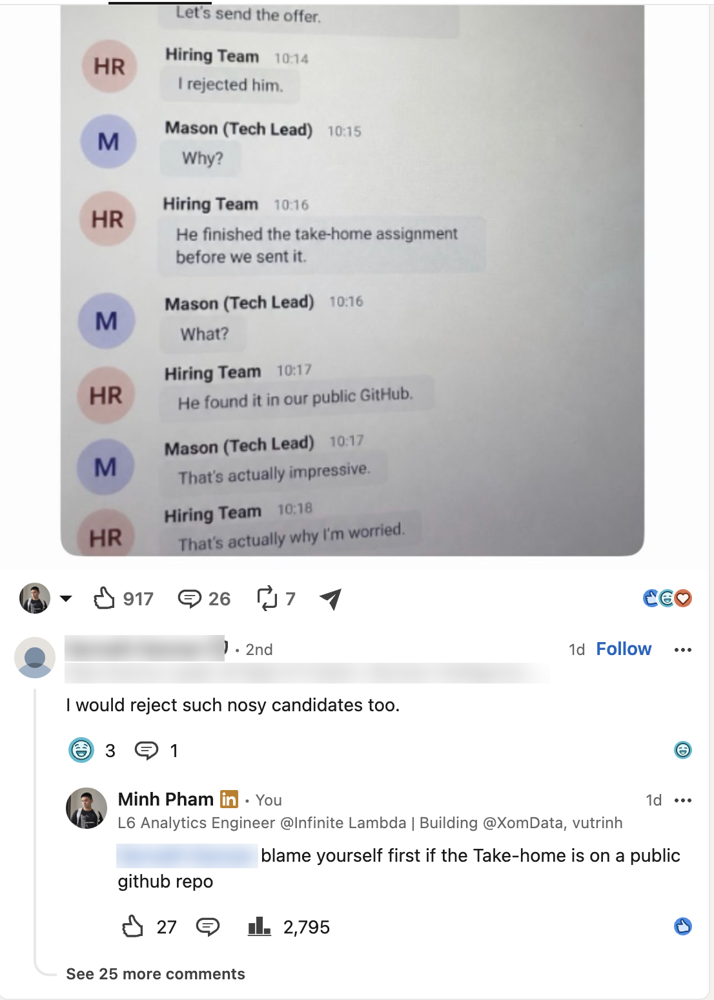

*Part of [Mentality](../README.md) · Previous: [8. Do it for the sake of doing it](../8-do-it-for-the-sake-of-doing-it/README.md) · Next: [10. Be proactive](../10-be-proactive/README.md)*

# 9. Learn to say no, disagree, and spot BS

LinkedIn, Facebook groups and career TikTok are full of confident people saying unhinged things. Some have big titles. Some have big followings. And if you nod along with something stupid, you look just as stupid, or worse, you start believing it and acting on it.

**Spotting BS is a skill.** Honestly, it's an art. And it matters as much as anything technical you'll learn.

## An example

A post went viral on LinkedIn: a chat screenshot where HR rejects a candidate because he found the take-home assignment in the company's **public** GitHub repo and finished it before they even sent it. Then a commenter with "Data Science Leader" in his headline weighed in:

> I would reject such nosy candidates too.

Think about it for a second. The company put its own take-home assignment in a public repo. The candidate found it, did the work early, and did it well. That's initiative, and arguably exactly what you'd want in an engineer. So my reply was simple: **blame yourself first if the take-home is on a public GitHub repo.**

The title didn't make the take right. And plenty of people agreeing with something doesn't make it right either.

## How to spot it

Take a step back before you react, agree or repost.

1. **Look at what they're actually saying.** Strip away the confident tone and the formatting. What's the claim? Is there any evidence, or just a story? Is it specific, or vague enough to sound deep while saying nothing?
2. **Look at their background.** Have they actually done the thing they're talking about? A recruiter on engineering, an engineer on recruiting, a course seller on "what employers really want": all of these can be right, but they deserve a second look.
3. **Look at where they're coming from.** What do they gain if you believe them? Engagement, followers, course sales, defending a decision they already made? Incentives explain a lot of opinions.
4. **Check it against what you know.** Does it hold up from first principles? Against your own experience? Against people you trust who've actually done it?

### Red flags

- **"X is dead"** (SQL is dead, data analysis is dead, Power BI is dead), usually followed by something to buy.
- **"Nobody is talking about this"** about something everyone is talking about.
- **Screenshots of conversations that are too perfect,** with a clean moral at the end. A lot of them are made up for engagement.
- **A title used as the argument** instead of a reason.
- **Guaranteed results:** "Do these 5 things and you'll get hired in 30 days."
- **Rage bait** designed to make you comment, not to make you think.

## Then decide whether to call it out

Spotting it is the skill. Calling it out is your choice. Sometimes it's worth it, especially when beginners might take the bad advice seriously. Sometimes scrolling past is the smarter move.

If you do speak up:

- **Go after the argument, not the person.**
- **Keep it short and specific.** One clear line beats a paragraph.
- **Make sure you can back it up** ([poker](../2-play-it-like-poker/README.md) rules apply here too).

## Learn to say no and to disagree

The same skill applies off social media:

- **Say no to bad advice,** even when it comes from someone senior, someone with a big following or someone you like.
- **Say no to things that don't fit you:** roles, projects, "opportunities" that are really just unpaid work for someone else. Being able to say no is what having options looks like ([Detach](../3-detachment/README.md)).
- **Disagree at work, respectfully.** "I see it differently, here's why" is something good teams want to hear. Nodding along to a plan you think is wrong doesn't make you a team player; it makes you part of the mistake.

You don't have to win every argument. But you should never agree with something just because of who said it, or how many people liked it.

*Part of [Mentality](../README.md) · Previous: [8. Do it for the sake of doing it](../8-do-it-for-the-sake-of-doing-it/README.md) · Next: [10. Be proactive](../10-be-proactive/README.md)*
