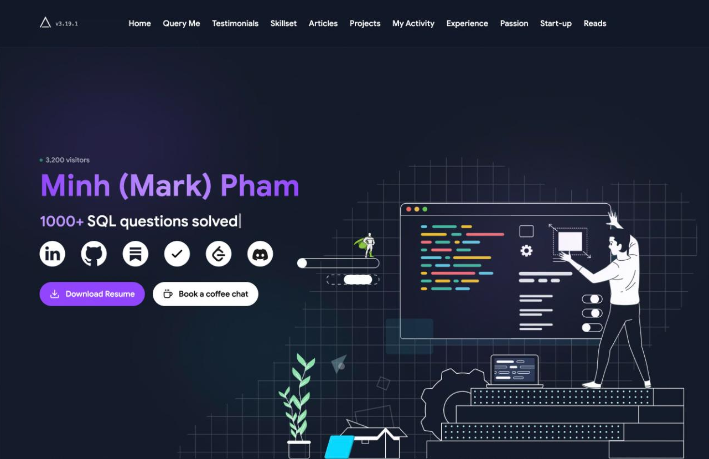
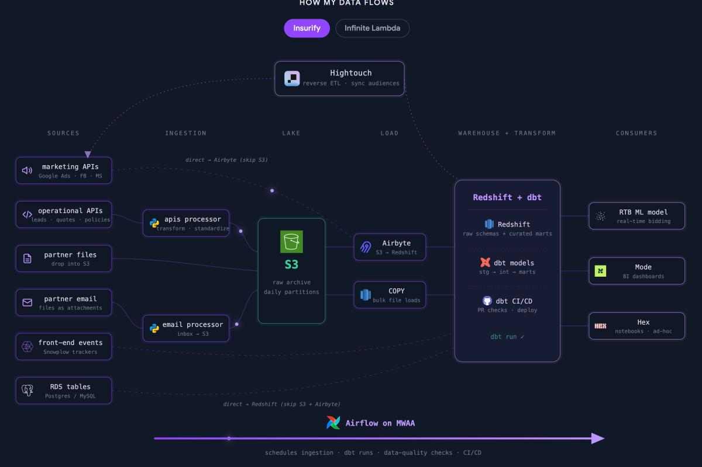
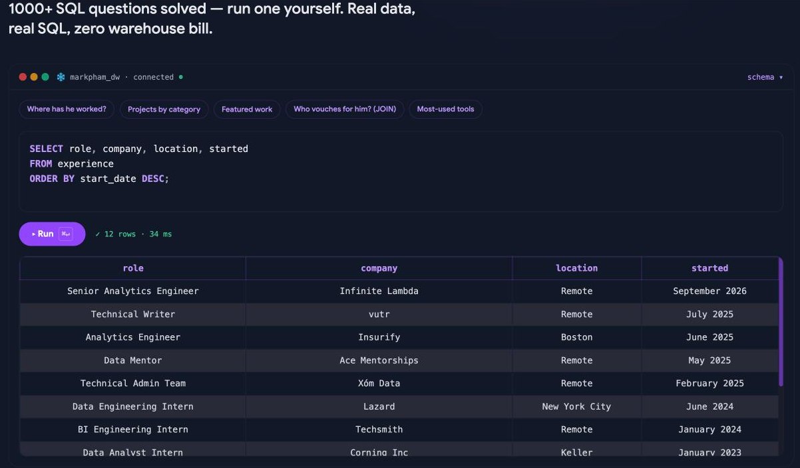
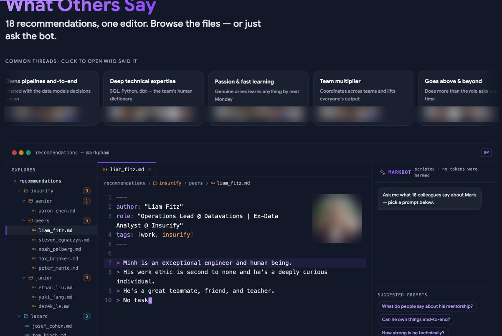
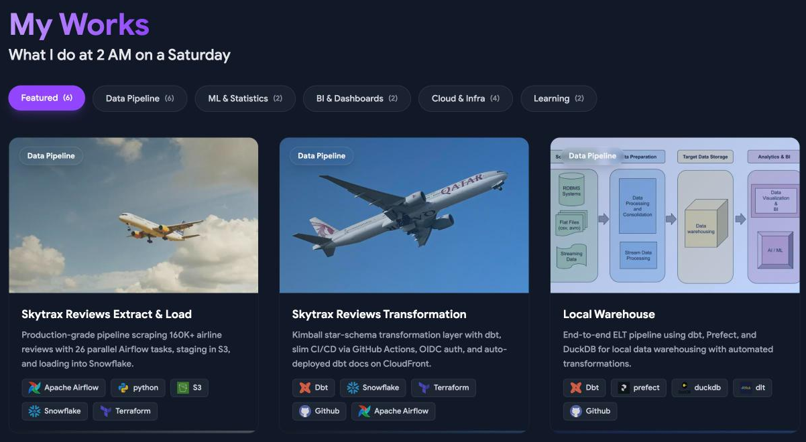
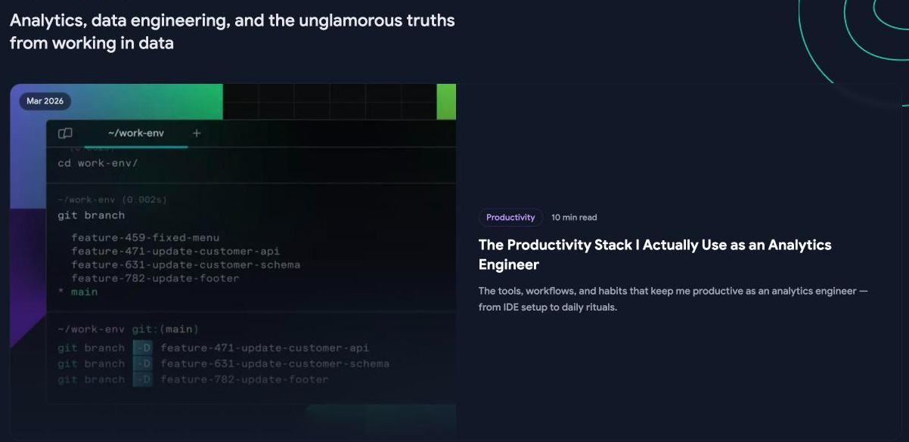
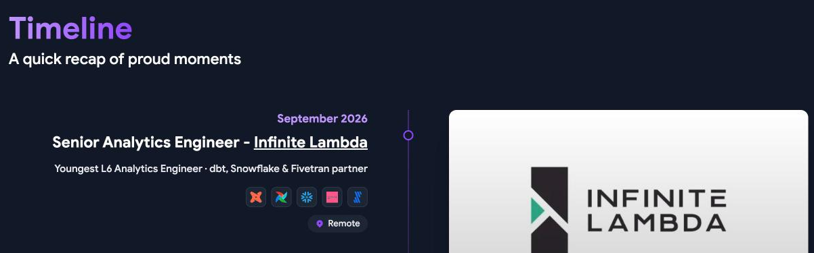
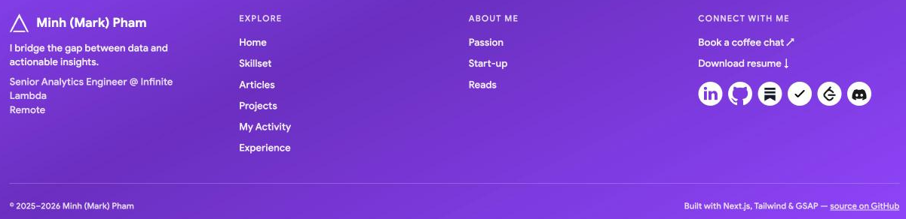

# Building a portfolio site

LinkedIn and GitHub are must-haves. A portfolio site is optional, but it's the one place where **you** control the whole story: what people see first, how your projects are explained, and what it feels like to read about you. Done well, it's the link people forward to each other.

It's also the easiest place to become a minion. Hundreds of candidates fork the same popular templates, swap in their name and the same Titanic and Netflix projects, and end up with sites a recruiter could mistake for each other. **A portfolio only helps if someone remembers it after closing the tab.**

This guide covers how to ship one fast, then walks through a portfolio from top to bottom, with a screenshot of the same section of [my site](https://minhbpham.com) (v3.19, November 2026) in each part. Each section ends with a short checklist, and the full [self-review checklist](#self-review-checklist) is at the end.

---

## Before you build: should you?

Build one if any of these are true:

- You have **3+ projects** worth explaining in more depth than a GitHub README.
- You write (or want to write) case studies, articles or analyses.
- You're applying to roles where presentation matters (analytics, BI, consulting, anything client-facing).

If you don't have projects yet, spend the time on projects first. An empty portfolio is worse than none.

**Checklist:**

- [ ] At least one is true: I have 3+ projects worth explaining, I write, or presentation matters for the roles I want. If none are, I'm building projects first.

## Ship fast from a template, then make it yours

You're a data person, not a front-end developer, and that's fine.

- **Start from an open-source template.** Search GitHub for "developer portfolio" templates, pick one you like, check its license (MIT is ideal), and **credit the original author** in your README.
- **Or use a no-code builder** (Notion-based sites, Framer, Carrd) if you'd rather spend zero time on code.
- **Deploy for free:** Netlify, Vercel or GitHub Pages all deploy automatically when you push to `main`.
- **Buy a domain:** `yourname.com` costs little per year and looks far more serious than `yourname.netlify.app`.

Ship a simple version in a weekend, then improve it. A live site with 80% polish beats a perfect site that's never deployed.

**But a template is where you start, not where you finish.** Popular templates have thousands of forks. If a recruiter has seen the template demo, and they have, a site that still looks like it says "I filled in a form". Every month, change something until the site stops looking like the template.

**On my site:** I started from [folio](https://github.com/ayush013/folio) by Ayush Singh (MIT, credited in my README). It's built with Next.js, Tailwind CSS and GSAP, deployed on Netlify from `main`, on a custom domain. All the content (roles, projects, skills, testimonials, links) lives in one file, `constants.ts`, so adding a new job is a single edit, and a changelog (`VERSION.md`) records every change. The sections that make it memorable (the data-flow diagram, the SQL editor, the testimonials IDE below) aren't in the template at all; I added them one at a time.

**Checklist:**

- [ ] Template license checked, and the original author credited in my README.
- [ ] Deployed automatically from `main`, on a custom domain.
- [ ] **Copy-paste test:** someone who knows the template I started from wouldn't recognise it.

---

## 1. Hero

Your name, your role, one line on what you do, and your main calls to action, all visible without scrolling. Put your **only-me facts** here (the number, the community, the tool), the same ones as your LinkedIn headline.

**On my site:** my name, then a typed line that rotates through facts (*"1000+ SQL questions solved"*, my role, my university, *"Remote"*), icons for every profile, and two buttons: **Download Resume** and **Book a coffee chat**. There's also a small visitor counter, which is a bit of fun and also proof that people actually visit.

**Checklist:**

- [ ] Name, role, one-line pitch and calls to action are visible without scrolling.
- [ ] The same only-me facts as my LinkedIn headline.

## 2. Show how you work

Most portfolios *say* "I build data pipelines". Show one instead. A diagram of a real architecture you've worked on tells a hiring manager more in five seconds than a paragraph of skills.

**On my site:** *"How my data flows"* is an architecture diagram of real stacks I've worked on, from sources through ingestion, lake, load and warehouse to consumers. You can switch between my Insurify and Infinite Lambda stacks. It's specific (Airbyte, S3, Redshift + dbt, Hightouch, Airflow on MWAA), so it's obviously mine and not a stock image.

**Checklist:**

- [ ] At least one diagram of real work I've done, specific enough that it's obviously mine.

## 3. Something interactive

One interactive thing that matches your field makes your site unforgettable, because the visitor *does* something instead of just reading. For a data person: a live query, a chart built from your own data, a small tool.

**On my site:** *"Query my career"* is a SQL editor over a small warehouse of my own career data: *"1000+ SQL questions solved — run one yourself. Real data, real SQL, zero warehouse bill."* There are preset queries (*Where has he worked?*, *Who vouches for him? (JOIN)*), and pressing **Run** returns real rows. A recruiter who's read 100 portfolios has never read one they could query.

**Checklist:**

- [ ] The visitor can do something, not just read: a query, a chart from my own data, a small tool.

## 4. What others say

A quote from a manager, mentor or teammate is worth more than any adjective you write about yourself. Ask for recommendations on LinkedIn (see the [LinkedIn guide](../linkedin/README.md#12-recommendations)), then reuse them here with permission.

**On my site:** *"18 recommendations, one editor. Browse the files — or just ask the bot."* The recommendations are laid out like a code editor, with one markdown file per person, organised in folders by company and seniority. Above them, "common threads" summarise what people say most (*Owns pipelines end-to-end*, *Deep technical expertise*, *Team multiplier*). There's also a scripted "MarkBot" (*"no tokens were harmed"*) that answers questions like *"What do people say about his mentorship?"* The same 18 quotes as a plain list would be easy to skip; this way people actually read them.

**Checklist:**

- [ ] Quotes from real managers, mentors or teammates, used with their permission.

## 5. Projects as case studies

The core of the site. A project card that says "Built a dashboard with Power BI" is forgettable. Write each one up like a small case study:

- **The question:** what problem were you solving, and for whom?
- **The data:** where it came from, how big, how messy.
- **The approach:** architecture diagram, key decisions and trade-offs.
- **The result:** a screenshot, a number, an insight.
- **What you'd change:** shows judgement.

Two or three projects written up like this beat fifteen one-line cards. Every project should link to a repo with a proper README (see the [GitHub guide](../github/README.md)).

**On my site:** *"My Works — What I do at 2 AM on a Saturday."* Projects are filterable by category (Featured, Data Pipeline, ML & Statistics, BI & Dashboards, Cloud & Infra, Learning). Each card has an image, a one-line description with a number in it (*"Production-grade pipeline scraping 160K+ airline reviews with 26 parallel Airflow tasks"*) and the stack as icons.

**Checklist:**

- [ ] 2–3 projects written up as case studies: question, data, approach, result, what I'd change.
- [ ] Each one shows a result: a screenshot, a number or an insight.
- [ ] Each one links to a repo with a proper README.

## 6. Writing

Articles, case studies, blog posts. Even two good ones show you can communicate, which is half of a data job. Write about what you actually did or think, not "10 SQL tips".

**On my site:** *"Analytics, data engineering, and the unglamorous truths from working in data"*, with posts like *"The Productivity Stack I Actually Use as an Analytics Engineer"*. Each has a date, a tag and a read time.

**Checklist:**

- [ ] Every piece is about something I actually did or think, not "10 SQL tips".

## 7. Experience timeline

Your roles with dates and a line or two each, **matching LinkedIn exactly**. A visual timeline is easier to scan than a list.

**On my site:** *"A quick recap of proud moments."* Each role has its date, title and company, a one-line subtitle (*"Youngest L6 Analytics Engineer · dbt, Snowflake & Fivetran partner"*), the stack as icons, and the location.

**Checklist:**

- [ ] Every role has dates and a line or two, matching LinkedIn and my resume exactly.

## 8. Contact and footer

Make it trivially easy to reach you: email or a booking link (Calendly, Cal.com), your resume as a PDF that's always the latest version, and links to every profile. Repeat them in the footer so they're there wherever someone stops scrolling.

**On my site:** the footer repeats **Book a coffee chat** and **Download resume**, every profile link, and a "source on GitHub" link, which is itself proof of work.

**Checklist:**

- [ ] An email or booking link.
- [ ] A resume PDF that's the latest version.
- [ ] Links to every profile, repeated in the footer.

---

## The technical basics

- **Mobile:** most recruiters will first open your link on a phone. Check it there.
- **Speed:** run Lighthouse (Chrome DevTools) and fix anything red. Compress images.
- **Page title and description:** set them, so search results and browser tabs show your name and role.
- **Share preview:** add an Open Graph image, so the link looks good when pasted into LinkedIn, Slack or Messenger.
- **No broken links:** click every link before you share the site.
- **Keep content in one place:** if all text, projects and roles live in one data file, updating the site takes minutes instead of hunting through components.

**Checklist:**

- [ ] Checked on a phone.
- [ ] Lighthouse has nothing red.
- [ ] Page title, description and Open Graph image are set.
- [ ] I clicked every link, and none are broken.

## Keep it current

An outdated portfolio is worse than none. Every time something changes (new job, new project, new article), update LinkedIn, GitHub and the portfolio **together**, so all three tell the same story with the same titles and dates.

**Checklist:**

- [ ] My latest job, project and article are on LinkedIn, GitHub and my portfolio, with the same titles and dates.

---

## Common mistakes

- **A minion portfolio:** the template demo with your name swapped in, the same projects as everyone else, and an About that could be anyone's.
- Template placeholder text or the template author's name still on the page.
- Projects with no links, or links to empty repos.
- Experience dates that don't match LinkedIn.
- So much animation that it's slow or hard to read on a phone.
- An old resume PDF.
- No way to contact you.

---

## Self-review checklist

**Make it yours**

- [ ] **Copy-paste test:** someone who knows the template I started from wouldn't recognise it.
- [ ] My only-me facts are visible on the first screen.
- [ ] At least one thing on the site that nobody else's portfolio has (a diagram of my real work, something interactive, my own data).

**Top to bottom**

- [ ] Hero shows my name, role, one-line pitch and calls to action without scrolling.
- [ ] Testimonials from real people, with their permission.
- [ ] 2–3 projects written up as case studies: question, data, approach, result, what I'd change.
- [ ] Every project links to a repo with a proper README.
- [ ] Experience titles and dates match LinkedIn and my resume exactly.
- [ ] Contact link and an up-to-date resume PDF, repeated in the footer.

**Basics**

- [ ] Live on a custom domain, deployed automatically from GitHub.
- [ ] Checked on a phone; Lighthouse has nothing red.
- [ ] Page title, description and share image are set.
- [ ] No template placeholder text, no broken links.
- [ ] Template author credited if I used one.
