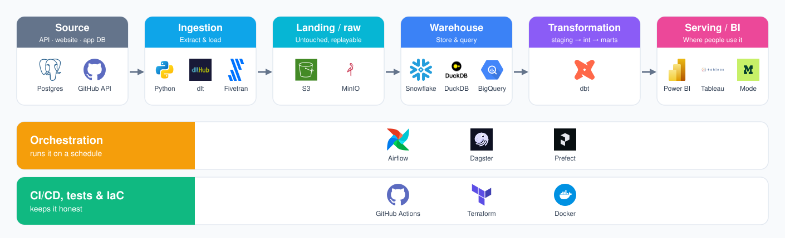

# Building data projects that get you hired

A project is the only part of your application that isn't a claim. Your resume says you know SQL, dbt and Airflow. A project shows it. That's why it's the first thing I open when I review a mentee, and the first thing a good hiring manager opens too.

**When you're going for your first data role, projects are your main competitive advantage.** You don't have years of experience to compete on, and neither does anyone else in the pile. What you can control is what you build. On your resume, aim for **2 to 3 projects alongside 2 to 3 experiences** (non-US internships, part-time jobs, research, a club role). That's the best format for a one-page resume at this stage. More projects than that means each one gets a single shallow line; fewer means your resume rests on experience you don't have yet. More in the [resume guide](../resume/README.md#3-projects).

The problem: most data projects look the same. Download a Kaggle CSV, open a notebook, make a few bar charts, call it "Sales Analysis". Or follow a YouTube "end-to-end data engineering project" step by step and end up with the exact same repo as 10,000 other people. Those are **minion projects**. They prove you can follow instructions. Everyone can.

This guide has two parts:

1. **This page:** what a data stack looks like, layer by layer, and what each role (data analyst, analytics engineer, data engineer) should show in a project.
2. **[Project ideas and data sources](ideas/README.md):** how to pick a data source, from a static CSV up to your own crawler, plus project ideas for each role.

Once the project exists, the [GitHub guide](../github/README.md) covers how to present it.

---

## Before you start: pick the role, then the project

Don't start with the tool ("I want to learn Kafka"). Start with the job you're applying for, then build the project that job would review.

I think about data people in two groups:

- **Producers** put data into the warehouse and make it trustworthy: data engineers and analytics engineers.
- **Consumers** take data out of the warehouse and turn it into decisions: data analysts and data scientists.

A data analyst project that spends 80% of its README on Terraform is aimed at the wrong reader. A data engineer project that's a notebook with charts is too. Know which side you're on, and make the part of the stack your role owns the deepest part of your project.

You don't need to build the whole stack every time. But you need to know where your work sits in it, because every interviewer will ask.

---

## The data stack, layer by layer

Almost every modern data platform, from a laptop project to a company with 500 engineers, has the same layers. The tools change; the layers don't.

| Layer | What it does | Example tools | The question an interviewer asks |
|---|---|---|---|
| **Source** | Where the data is born: an API, a website, an app database, a file | REST APIs, websites, Postgres, Kaggle CSVs | Why this data? Who else has it? |
| **Ingestion (Extract & Load)** | Gets data out of the source and into your platform, ideally only what's new | Python + `requests`, dlt, Fivetran, Airbyte | What happens if it fails halfway? How do you load only new rows? |
| **Landing / raw** | Stores data exactly as it arrived, untouched, so you can always replay | S3, GCS, local Parquet files, a `raw` schema | Can you rebuild everything from here if a model is wrong? |
| **Warehouse** | Where data is stored and queried | Snowflake, BigQuery, Redshift, DuckDB, Postgres, ClickHouse | Why this warehouse? What does it cost? |
| **Transformation** | Cleans, renames, joins and models raw data into tables people can use | dbt (staging → intermediate → marts), SQL | What's the grain of this table? How do you know it's right? |
| **Serving / BI** | Where people actually use the data | Power BI, Tableau, Mode, Omni, Streamlit, a notebook | What decision does this dashboard help someone make? |
| **Orchestration** | Runs the steps in order, on a schedule, with retries | Airflow, Dagster, Prefect, cron, GitHub Actions | What runs when, and what happens when step 2 fails? |
| **Quality, CI/CD and infra** | Tests, linting, deployments and infrastructure as code | dbt tests, SQLFluff, GitHub Actions, Terraform, Docker | How would a teammate run this? How do you stop bad data reaching the dashboard? |

Three things to notice:

- **ELT, not ETL.** Modern stacks load raw data first and transform it inside the warehouse. That's why the landing layer matters: raw data you never overwrite means a broken model is a re-run, not a disaster. If you want the longer version, read [I tell people I'm an AE, but wtf does that mean?](https://markphammm.substack.com/p/i-tell-people-im-an-ae-so-wtf-does)
- **You can run the whole stack on a laptop.** DuckDB as the warehouse, Parquet files as the landing zone, dbt Core, Prefect or Dagster, and a free BI tool. No cloud bill, and a reviewer can clone it and run it. Cloud (Snowflake, S3, Terraform) is a level up, not a requirement.
- **Each layer is a separate concern.** Your ingestion code shouldn't clean data. Your dashboard shouldn't contain business logic that belongs in a dbt model. Mixing layers is the first thing I look for in a review.

The tour of how these tools fit together, plus the software engineering basics (repo structure, virtual environments, env vars) every project needs, is in my two-part Substack series: [Part 1: The prerequisite](https://markphammm.substack.com/p/component-of-a-technical-data-project) and [Part 2: Building blocks](https://markphammm.substack.com/p/component-of-a-technical-data-project-59e).

**In my projects:** [local_warehouse_pipeline](https://github.com/MarkPhamm/local_warehouse_pipeline) is the whole stack on one laptop: the CFPB consumer complaints API → dlt and PyArrow → Parquet in a `landing/` folder → DuckDB → dbt → dashboards, orchestrated by Prefect, with GitHub Actions CI. Zero cloud dependencies. [Skytrax reviews](https://github.com/MarkPhamm/skytrax_reviews) is the same shape in the cloud: a scraper, 26 parallel Airflow tasks, S3 as the landing zone, Snowflake, dbt and Terraform.

---

## What each role's project should show

Same stack, different depth. Here's where each role should spend most of its effort, and what I look for when I review it.

| | Data analyst | Analytics engineer | Data engineer |
|---|---|---|---|
| **Owns** | Serving / BI | Transformation | Ingestion, warehouse, infra |
| **Main output** | A dashboard or analysis that answers a question | A tested, documented data model | A pipeline that runs reliably without you |
| **Can be light on** | Ingestion and infra (a clean dataset is fine) | Infra (a local DuckDB is fine) | The dashboard (one simple chart is fine) |
| **First thing I open** | The dashboard and the "so what" | The dbt lineage graph and the tests | The architecture diagram and the DAG |

### 1. Data analyst: the question, the SQL, the dashboard, the takeaway

An analyst gets paid to help someone make a better decision. Your project should look like that, not like a chart gallery.

- **A real question.** "Do flash sales on Shopee actually save you money?" beats "E-commerce sales analysis". Write the question at the top of the README. If you can't write it in one sentence, you don't have a project yet.
- **The SQL.** Analysts are hired on SQL. Put your queries in the repo as `.sql` files, not buried in a notebook or hidden behind a BI tool's drag-and-drop. CTEs over nested subqueries, readable aliases (no `t1, t2, t3`), window functions where they fit. A reviewer should be able to read your SQL and follow your thinking.
- **The dashboard UI.** Design for the person reading it, not for yourself:
  - The most important number top-left, big. Details below and to the right.
  - One question per page. If a page needs a paragraph to explain, split it.
  - No 3D charts, no pie charts with 12 slices, no rainbow colour schemes. Colour means something or it's grey.
  - Filters that a stakeholder would actually use (date, region, segment), not every column in the table.
  - Check it against **ACES**: Accurate, Clear, Empowering, Succinct. More in [How to design a dashboard](https://www.facebook.com/share/p/1CWqrpxXHC/) and [Power BI or Tableau? Wrong question.](https://markphammm.substack.com/p/power-bi-or-tableau-wrong-question)
- **The takeaway.** This is what separates an analyst from someone who knows Power BI. End with 3 to 5 findings and what you'd recommend: *"Reviews mentioning delays score 2.1 points lower, and delays are 40% of 1-star reviews. If I ran this airline, I'd fix on-time performance before seat comfort."* (Illustration only, don't copy it.) Charts without a conclusion are homework.
- **Honest limits.** Sample size, bias in the data, what you couldn't answer. Interviewers love this.

**Where analysts go wrong:** the Superstore dashboard, 15 charts with no story, "insights" that restate the chart ("Sales were highest in Q4"), and no SQL anywhere.

### 2. Analytics engineer: the model, the tests, the docs

An analytics engineer turns raw data into tables the business can trust. Your project should show you can design that model, not only write `SELECT`s.

- **Layered dbt models.** Staging (one model per source table: rename, cast, nothing clever) → intermediate (joins, business logic) → marts (what BI reads). Every layer has one job. Name them consistently (`stg_`, `int_`, `fct_`, `dim_`).
- **A deliberate data model.** Kimball star schema with facts and dimensions is the safe default. Know and write down the **grain** of every fact table ("one row per review"). Surrogate keys, slowly changing dimensions if your data needs them. Draw the ER diagram.
- **Data quality checks.** `unique` and `not_null` on every primary key is the floor, not the ceiling. Add `relationships` between facts and dimensions, `accepted_values`, freshness checks on sources, and at least one custom test for a business rule only your data has. Show what happens when a test fails.
- **Incremental models** where the data is large or append-only, and an explanation of why.
- **Docs.** Descriptions on models and columns, generated dbt docs, ideally hosted somewhere a reviewer can click.
- **CI.** A GitHub Actions workflow that runs SQLFluff and `dbt build` on pull requests. Slim CI (`state:modified+`) if you want to go one level deeper.
- **A thin serving layer.** One dashboard or a semantic layer (MetricFlow) on top of your marts, to prove the model answers real questions.

**Where analytics engineers go wrong:** one giant model with 400 lines of SQL, tests only on one column, no stated grain, "dbt project" that's really a folder of views with no layers, and the jaffle shop sample with a new name.

### 3. Data engineer: ingestion, reliability, infrastructure

A data engineer gets data from where it lives to where it's needed, every day, without anyone babysitting it. Your project should prove it keeps running when you're not watching.

- **Real ingestion.** Pull from an API or a website, not a CSV you downloaded once. Handle pagination, rate limits, retries and auth. See [picking a data source](ideas/README.md#picking-a-data-source).
- **Incremental and idempotent loads.** Load only new or changed data (by date, ID or CDC). Running the same job twice must not create duplicates. This is the most common interview question about a DE project; have a good answer.
- **A landing zone.** Raw data in S3 or Parquet files, partitioned by load date, never overwritten.
- **Orchestration.** A DAG with clear tasks, retries, and backfills. Parallelise where it helps and explain why.
- **Infrastructure as code.** Docker Compose so anyone can run it locally. Terraform for cloud resources, IAM roles and warehouse permissions. No clicking around in a console that nobody can reproduce.
- **Secrets and auth done properly.** Env vars or a secrets manager, never keys in the repo. OIDC or key-pair auth for CI if you go to the cloud.
- **Depth on one hard thing.** Streaming (Kafka, Spark, Flink), CDC, a lakehouse (Iceberg, Trino), performance on a big dataset. One hard thing done well beats five tools name-dropped.

**Where data engineers go wrong:** a "pipeline" that's one Python script run by hand, full reloads of everything every time, an Airflow DAG with a single task, a Kafka setup with nothing actually streaming, and the same YouTube Spotify/Reddit pipeline everyone else built.

**In my projects:** I split Skytrax into two repos so each one goes deep on one role. [skytrax_reviews](https://github.com/MarkPhamm/skytrax_reviews) is the DE half: scraping 160K+ reviews with 26 parallel Airflow tasks, S3 staging, Snowflake and Terraform. [skytrax_reviews_transformation](https://github.com/MarkPhamm/skytrax_reviews_transformation) is the AE half: a Kimball star schema with 5 dimensions and 1 fact table, deterministic surrogate keys, slim CI on pull requests, `--defer --favor-state` deploys, OIDC so GitHub Actions never holds an AWS key, and dbt docs hosted on CloudFront. The analyst layer on top is a Mode report, and one of my mentees landed an internship offer with a Mode project on the same airline reviews. For streaming, [local_streaming_pipeline](https://github.com/MarkPhamm/local_streaming_pipeline) takes live Coinbase crypto prices through Kafka, Spark or Flink, into ClickHouse and a live dashboard, all with one `./run.sh`.

---

## What every project needs, whatever the role

- **A README a stranger can follow:** the problem, an architecture diagram, the stack, results, how to run it, what you'd do next. Template in the [GitHub guide](../github/README.md#5-inside-a-project-the-readme).
- **It runs on someone else's machine.** One command, or a short list of exact commands. If a reviewer can't run it, assume they won't try.
- **Numbers.** Rows processed, run time, cost, test count, how much faster. "160K+ reviews" is a fact; "a large dataset" is filler.
- **A reason for every tool.** "I used Kafka because it's popular" is a red flag. "I used DuckDB because it's free, local and fast enough for 2 GB" is an answer.
- **Your own decisions.** The part of the project you'd defend in an interview. If you can't explain a line, it came from a tutorial.

---

## Common mistakes

- **The minion project:** a Kaggle classic or a tutorial, followed step by step, with your name on it.
- **Tool soup:** Kafka, Spark, Airflow, Kubernetes and dbt on 5,000 rows of static CSV. Use the tools the problem needs, then go deep.
- **Wrong depth for the role:** an analyst project that's all infrastructure, or an engineering project that's all charts.
- **No question, no takeaway:** a dashboard that shows data but doesn't say anything.
- **Not runnable:** hard-coded paths, missing `requirements.txt` or `pyproject.toml`, secrets in the code.
- **Ten half-finished projects instead of two finished ones.** Finish, document, then start the next.

---

## Self-review checklist

**The basics**

- [ ] I can say which role this project is for, and the deepest part of it is the part that role owns.
- [ ] I can draw the stack from source to dashboard and point to where each tool sits.
- [ ] Every tool has a reason I'd say out loud in an interview.
- [ ] My resume has 2 to 3 projects next to 2 to 3 experiences, and this one is good enough to be one of them.

**By role**

- [ ] *Analyst:* one clear question at the top, SQL in the repo, a dashboard that passes ACES, and 3 to 5 takeaways with a recommendation.
- [ ] *Analytics engineer:* staging → intermediate → marts, a stated grain for every fact, tests beyond `unique` and `not_null`, docs, and CI.
- [ ] *Data engineer:* real ingestion, incremental and idempotent loads, a raw landing zone, orchestration with retries, and IaC or Docker.

**Presentation**

- [ ] The README has a diagram, real numbers, run instructions and "what I'd do next".
- [ ] A stranger can clone it and run it.
- [ ] No secrets in the repo or its history.

**The copy-paste test**

- [ ] Could 1,000 other candidates have this exact repo? If yes, change the data, the question or the depth until the answer is no. Start with [the ideas page](ideas/README.md).

— Mark Pham
