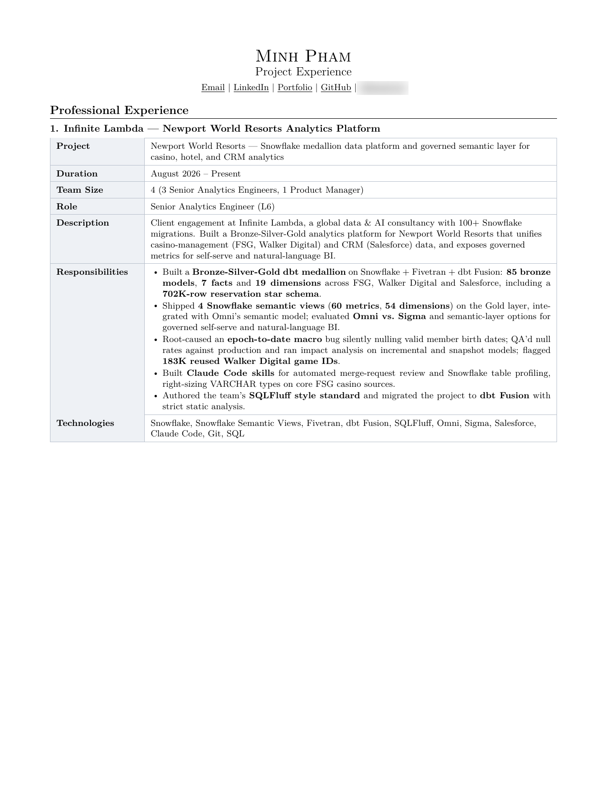
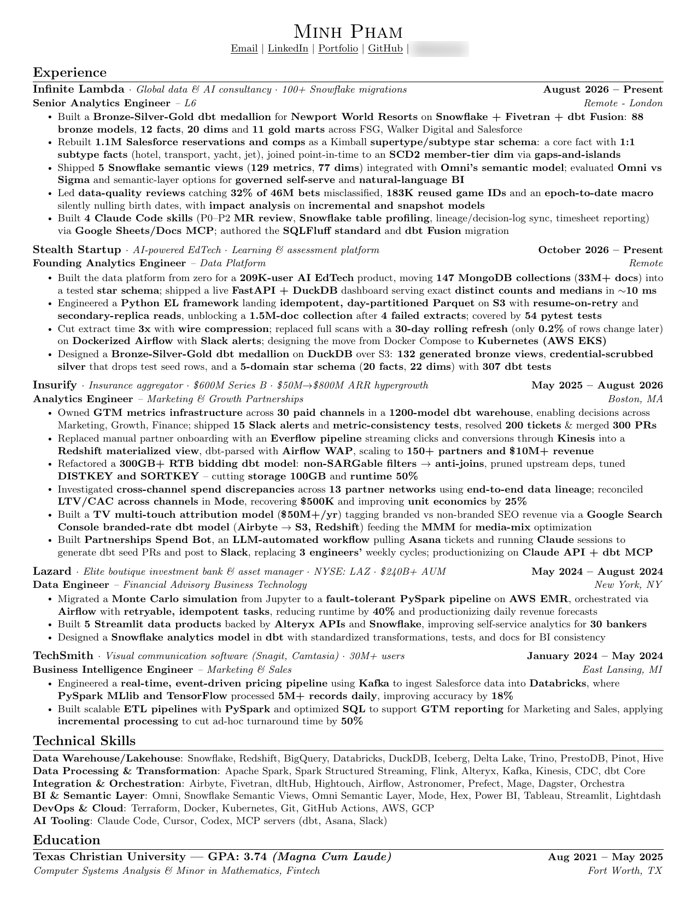
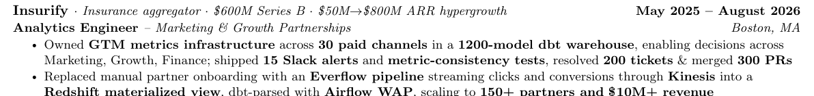
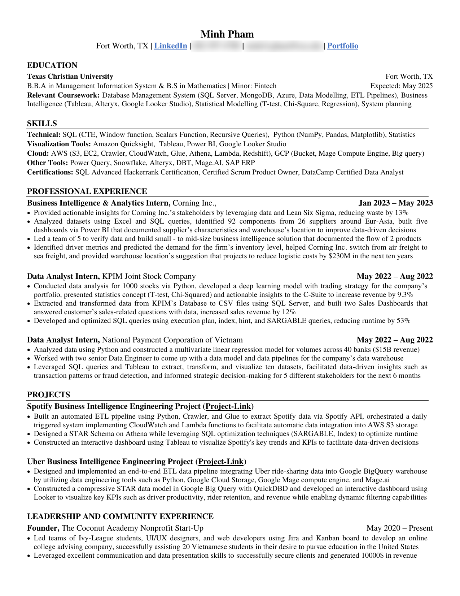
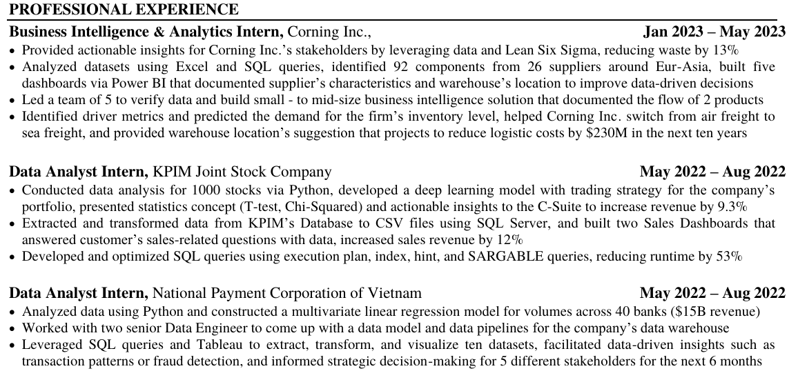
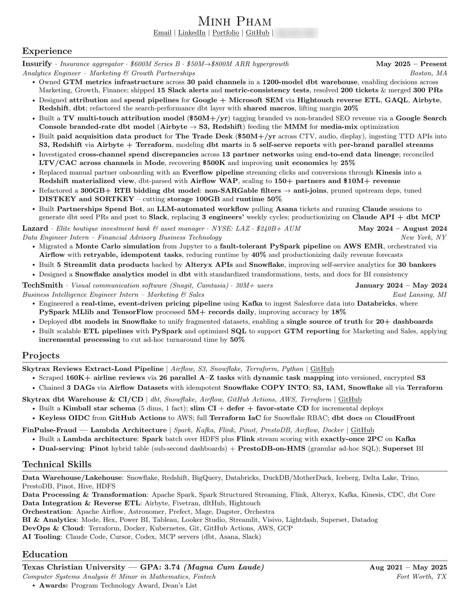

# Building a resume that gets you the interview

A recruiter skims your resume in seconds before deciding whether to read it properly. Before that, an applicant tracking system (ATS) may parse it to match keywords against the job. So a resume has to work twice: **for a machine that reads text** and **for a human who skims**.

Most resumes fail the human, because they all look and read the same: a colourful two-column template with skill bars, an "Objective: seeking a challenging position…", and bullets that list duties. That's a **minion resume**.

There's one important twist compared with the other guides: **on a resume, the layout should look like everyone else's.** Recruiters read thousands of clean, single-column resumes, and they read them fastest. Don't differentiate with design. Differentiate with **content**: the numbers, the scope and the only-me facts.

This guide uses three versions of my own resume, so you can see what changed as I grew:

| Version | When | What it was for |
|---|---|---|
| [Junior year](#how-my-junior-year-resume-got-me-interviews) | 2023–24, Microsoft Word | Internship recruiting, with 3 internships already done |
| [Insurify era](#how-it-evolved) | 2026, LaTeX | Analytics Engineer with internships at Lazard and TechSmith |
| [Now](#how-it-evolved) | November 2026, LaTeX | Senior Analytics Engineer (L6) at Infinite Lambda |

My phone numbers and email addresses are blurred in the screenshots. There's a [self-review checklist](#self-review-checklist) at the end.

---

## Before you start

### Pick one target role

Same as LinkedIn: one job title, and the 10–15 keywords that repeat across real job posts for it. Those keywords go in your bullets and skills. Recruiters (and the ATS) are matching against them.

### Keep a brag document

You can't write strong bullets from memory six months later. Keep a running list of everything you ship, with the numbers, while it's fresh.

**What I do:** I keep two layers.

- **An achievements file:** a plain list of everything I shipped at each job. For Insurify, it's sourced from ~280 tickets assigned to me, plus my pull requests and Slack threads.
- **A long-form experience document:** 5 pages, one table per project, with duration, team size, role, description, responsibilities and technologies.



My one-page resume is a **selection** from these, not a summary written from scratch. When I apply to a specific role, I pick the bullets that match the job description. I never invent new ones.

### Find your only-me facts

Your layout should look like everyone else's; your content shouldn't. Before writing, list what's true about you and not about the pile: a number you produced, a tool people use, a community you run, data nobody else has, an unusual path. (The [LinkedIn guide](../linkedin/README.md#find-your-angle) has more on this.)

---

## Use LaTeX, and treat your resume as code

You can write a great resume in Word or Google Docs; my junior-year resume was a Word document. But I now recommend LaTeX for anyone in a technical field:

- **Consistent formatting for free.** Macros define how a job, a bullet and a section look, so every entry is identical. No more fighting with tab stops.
- **ATS-friendly when done right.** A single-column LaTeX resume produces clean, selectable text. My template includes `\pdfgentounicode=1` specifically so the PDF is machine-readable.
- **Version control.** It's plain text, so it lives in git. I can see every change I've made since January 2026 and roll back anything.
- **Tailoring is safe.** Make a branch or a copy per application without breaking the original.
- **AI assistants can edit it reliably.** Plain text plus clear rules (see below) is much easier for Claude or any other assistant to edit than a `.docx`.

**How to start:** open [Overleaf](https://www.overleaf.com) (free, runs in the browser, nothing to install) and pick a popular single-column resume template. Mine started as a variant of the widely used Jake's Resume / sb2nov template. Using a common template is fine here; it's what recruiters are used to reading.

**My setup** (optional, once you're comfortable):

- The `.tex` source lives in a **private** GitHub repo, so I can keep notes, job descriptions and drafts next to it.
- I compile locally with `pdflatex` (a VS Code task builds it with one shortcut).
- A **GitHub Action publishes only the PDF** to a public repo, [MarkPhamm/resume](https://github.com/MarkPhamm/resume), whenever the PDF changes. My resume link always points to the latest version, and the source stays private.
- The repo has a `CLAUDE.md` with the rules any edit must follow:

```markdown
- The whole resume must stay exactly 1 page. Never fix overflow by shrinking
  the font or margins; trim or tighten bullets instead.
- Every bullet should wrap to roughly 2 lines: dense enough to fill the line,
  never a 3–4 word fragment.
- Never invent claims. Every bullet must come from the achievements file.
- After any change: compile, confirm the PDF is exactly 1 page, and visually check it.
```

**If you stay in Word or Google Docs:** use a single column, no text boxes, no tables for layout, no icons or skill bars, standard section names, and export to PDF.

---

## Section by section

These follow the order of my current resume, top to bottom.



### 1. Header

- Your name, then one line of links: **Email | LinkedIn | Portfolio | GitHub | phone**. Make every one clickable.
- A city (or "Remote") is enough; never your full address.
- No date of birth, no "Resume" or "Curriculum Vitae" title, and no photo unless your target market expects one (in the US and UK it doesn't).
- Name the file `Firstname_Lastname_Resume.pdf`, not `resume_final_v3.pdf`.

### 2. Experience

The most important section by far.

**Start each company with one line of context.** Recruiters may not know every company, and the context tells them the scale of what you worked on:



*"Insurify · Insurance aggregator · $600M Series B · $50M→$800M ARR hypergrowth"*: in one line, you know what the company does, how big it is, and that I worked there during hypergrowth.

**Then the title (with team), dates and location,** then the bullets.

**Every bullet is action + tool + scope + result:**

> ❌ Responsible for maintaining dbt models for the marketing team.
>
> ✅ Refactored a 300GB+ RTB bidding dbt model: non-SARGable filters → anti-joins, pruned upstream deps, tuned DISTKEY and SORTKEY – cutting storage 100GB and runtime 50%

- **Numbers wherever they're honest:** money, time, rows, users, partners, tests, PRs. If a number is a projection, say so ("projected to…").
- **Bold the numbers and key tools** so a skimmer catches them. My current resume does this in every bullet.
- **Name the specific technique,** not just the tool. "Anti-joins", "SCD2 via gaps-and-islands", "idempotent day-partitioned Parquet" tell an expert you actually did it.
- **Lead with the most impressive bullet** in each role.
- **More bullets for recent roles, fewer for older ones.** My current role has 4–6 bullets; TechSmith, from 2024, is down to 2.
- **Same titles and dates as LinkedIn.** Recruiters and background checks compare them.

### 3. Projects

Projects carry a lot of weight while you have little experience, and less as your work starts to speak for itself.

- Put the stack and a link on the title line: *"Skytrax Reviews Extract-Load Pipeline | Airflow, S3, Snowflake, Terraform, Python | GitHub"*.
- 2 bullets each, written exactly like experience bullets.
- **Skip the projects every candidate has** (Titanic, Netflix, Superstore, tutorial follow-alongs). See [projects nobody else has](../github/README.md#before-you-start-projects-nobody-else-has).

**On my resume:** my junior-year resume had two projects. The Insurify-era one had three deeper ones (my own scraped Skytrax data, a dbt warehouse with CI/CD, a Lambda-architecture fraud pipeline). In October 2026 I dropped the Projects section entirely, because my work experience now says more than side projects could.

### 4. Technical skills

- Group by category (warehouse, processing, orchestration, BI, cloud, AI tooling), one line each.
- **Only list what you can defend in an interview.** Every item is an invitation for a question.
- No skill bars, stars or percentages. "Python ★★★★☆" means nothing.

### 5. Education

- School, degree, dates, and GPA or honours if they help (mine: *GPA 3.74, Magna Cum Laude*).
- **While you're a student, Education goes first**, with relevant coursework. Once you have real experience, move it to the bottom, as I did.

### 6. Leadership and community (optional)

Clubs, communities, teaching, founding something. While you're early in your career, this is often where your only-me facts are. Write it like experience, with numbers.

---

## How my junior-year resume got me interviews



This is the Word resume I sent recruiters for internships during my junior year at TCU. Here's what made it stand out, and what I'd change today.

### What worked



- **Three internships before senior year, in two countries.** NAPAS (Vietnam's national payment network) and KPIM in Hanoi, then Corning, a Fortune 500 company, in the US. Most juniors have zero or one. The only-me fact was simply "already done this three times". If you can, start early: a summer internship back home counts.
- **Every bullet had a number.** 13% less waste, 92 components from 26 suppliers, 5 dashboards, a team of 5, 1,000 stocks, 9.3% revenue, 53% faster queries, 40 banks with $15B in revenue.
- **Business outcomes, not just tasks.** At Corning, the analysis helped the business *"switch from air freight to sea freight"*, with logistics savings *projected* at $230M over ten years. It's a decision someone made because of my work, and the bullet labels the projection honestly.
- **Depth that's unusual for a junior.** "Developed and optimized SQL queries using execution plan, index, hint, and SARGABLE queries, reducing runtime by 53%." A 20-year-old who talks about execution plans gets remembered.
- **Leadership with numbers.** "Led a team of 5" as an intern, and founding The Coconut Academy, a nonprofit that helped 20 Vietnamese students apply to US universities and generated $10,000 in revenue. That's the line that starts conversations in interviews.
- **Student-first layout.** Education at the top with two degrees (BBA in MIS, BS in Mathematics) and a Fintech minor, relevant coursework, then a skills block, because at that stage it's what recruiters screen for.

### What I'd change today

- **The projects.** The Spotify and Uber pipelines were good practice, but public APIs and datasets like these appear on a lot of student resumes. Today I'd swap them for something only I could have built, like my Skytrax scraper.
- **Fewer, tighter bullets.** Some cram three claims into one sentence. One claim per bullet reads faster.
- **Tighten the skills block.** It lists everything I'd touched. Today I'd keep only what I could defend in a technical interview and group it the way my current resume does.
- **Watch the details.** A couple of typos and inconsistent phrasing slipped through. On a one-page document, every one is visible.

---

## How it evolved

| | Junior year | Insurify era | Now |
|---|---|---|---|
| Tool | Word | LaTeX | LaTeX + git + CI |
| First section | Education | Experience | Experience |
| Projects | 2, cloud pipelines on public data | 3, deep and original (own scraped data, CI/CD, streaming) | Dropped |
| Leadership section | Yes (nonprofit founder) | No | No |
| Company context line | No | Yes | Yes |
| Bullets | Numbers in every bullet, some run-ons | Dense, specific techniques, bold key terms | Same, with fewer bullets for older roles |
| Length | 1 page | 1 page | 1 page |



The pattern: **as experience grows, the resume gets more focused, not longer.** Education moves to the bottom, projects and leadership make way for work, and older roles shrink to their best two bullets. It's still one page.

---

## Tailor every application

- Read the job description and highlight the keywords and the problems they mention.
- Reorder bullets so the most relevant ones come first, and swap in bullets from your brag document that match.
- Mirror their wording: if they say "semantic layer" and you've built one, call it a "semantic layer", not "a metrics layer".
- Keep a copy of every job description you apply to (I keep mine in a `jd/` folder next to the resume) so you can prepare for the interview later.

### It's a game of poker

Here's the part nobody tells you: a resume isn't a sworn statement, it's a hand of poker. **You can say whatever you want on it, as long as you can back it up.** Don't blame the player, blame the game: every other candidate in the pile is presenting the most impressive version of themselves. If you write yours like a modest, literal job description, you lose to them.

So sometimes you have to inflate yourself to look more impressive. But inflate too much, and someone in the interview calls your bluff.

- **If you don't bluff, you lose.** "Assisted the team with dashboards" when you built them yourself.
- **If you bluff too much, you lose.** "Architected the company's data platform" when you built three models in it. The first follow-up question exposes you, and now nothing else on the page is believed either.
- **If you play it too safe, you lose.** Bullets that list duties, round every number down and hide behind "helped" and "supported".
- **If you're too risky, you lose too.** Claims you can't explain, numbers you can't derive, tools you've only read about.

**Find your sweet spot.** The test: could you defend this line for 10 minutes while a senior engineer drills into it? If yes, play it, and play it with confidence: use the strongest verb that's defensible and the most generous number you can explain. If no, pull it back until you can.

| Too safe | Sweet spot | Bluff gets called |
|---|---|---|
| Helped maintain the marketing dbt models | Refactored the marketing dbt layer with shared macros, cutting runtime 30% | Led the company's dbt migration (you were one of five on it) |
| Assisted with a supplier dashboard | Built 5 Power BI dashboards covering 92 components from 26 suppliers | Built the company's supply-chain BI platform |
| Worked on a forecasting model | Built a demand forecast that informed a switch from air to sea freight, projected to save $230M over ten years | Saved the company $230M |

### Cards that are always face up

Some cards can't be bluffed, because anyone can check them: **employers, job titles, dates, degrees, GPA and certifications.** Background checks verify them, and recruiters compare them with your LinkedIn. Get caught bluffing here and you don't just lose the hand: offers get rescinded and people get fired, sometimes years later. **Bluff on how you frame your work, never on these facts.**

The [Mentality guide](../mentality/2-play-it-like-poker/README.md) covers the poker mindset beyond the resume: interviews, negotiation, and not going on tilt.

---

## Common mistakes

- **A minion resume:** a colourful two-column template, an objective statement, duty lists and the same tutorial projects as everyone else.
- Two pages as a student or new graduate.
- Bullets without a single number.
- Skills you can't defend in an interview.
- Titles or dates that don't match LinkedIn.
- Photos, skill bars, icons, tables or text boxes that confuse an ATS.
- Playing it too safe: duties and "helped with" instead of what you actually drove.
- Bluffing too hard: claims that collapse at the first follow-up question.
- Bluffing on face-up cards: employers, titles, dates, degrees, GPA.
- Projections presented as results.
- Typos, mixed tenses, inconsistent date formats.
- A file called `resume (3) final.pdf`.

---

## Self-review checklist

**Before you start**

- [ ] One target role and 10–15 keywords from real job descriptions.
- [ ] A brag document with everything I've shipped, with numbers.
- [ ] 3–5 only-me facts, and each appears somewhere on the page.

**Format**

- [ ] Exactly one page, single column, clean and familiar layout.
- [ ] Text is selectable in the PDF (copy-paste a line to check).
- [ ] File is named `Firstname_Lastname_Resume.pdf`.

**Content**

- [ ] Header: name and clickable Email | LinkedIn | Portfolio | GitHub | phone. No photo or full address.
- [ ] Each company has one line of context.
- [ ] Every bullet is action + tool + scope + result, with a number wherever it's honest.
- [ ] Projections are labelled as projections.
- [ ] Projects: none of the Titanic / Netflix / Superstore kind.
- [ ] Skills grouped by category, all defensible in an interview.
- [ ] Education first if I'm a student, last if I have real experience.
- [ ] Titles and dates match LinkedIn exactly.

**Finally**

- [ ] **Copy-paste test:** no bullet could appear unchanged on 1,000 other resumes.
- [ ] Tailored to this specific job description.
- [ ] **Poker test:** every line is as strong as I can make it, and I could defend each one for 10 minutes in an interview.
- [ ] No bluffs on face-up cards: employers, titles, dates, degrees, GPA, certifications.
- [ ] Read it out loud and fixed every typo.
